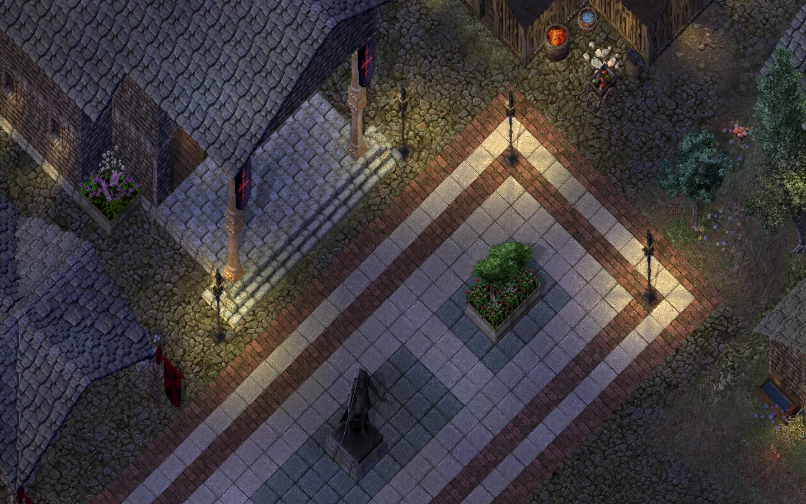
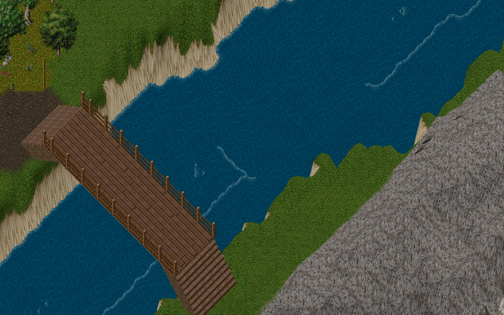
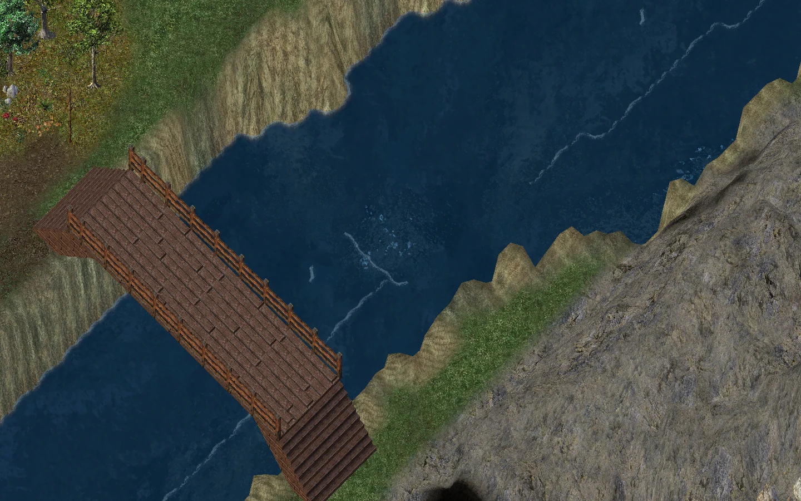
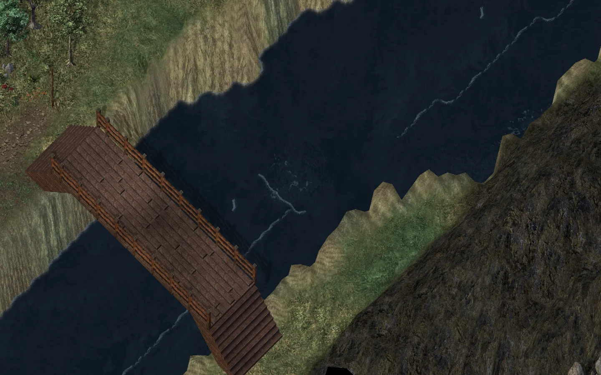
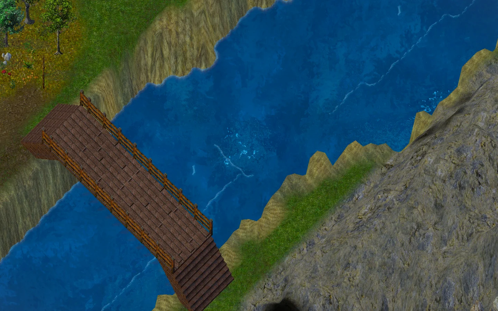

# UODynamapper and UOClientFiles Tools

UODynamapper is an interactive Ultima Online facet renderer written in Rust with Bevy. It supports four render styles: **Classic**, **Enhanced**, **KR-like**, and **UOD-Painterly**. KR-like recreates Kingdom Reborn's sun, static shadows, and night lighting and can draw with Kingdom Reborn terrain.

Dynamapper streams converted **UDDP packages** built from Classic and Enhanced Client data. The conversion tools can add Kingdom Reborn terrain and material data to those packages. The UOClientFiles library and its CLI and GUI tools work directly with the original client files.



*Britain at night in KR-like style, with Enhanced art and Kingdom Reborn terrain.*

## Four render styles

The same view of the Minoc river bridge in all four styles. Art and terrain sources are selectable independently of the style.

| Classic | Enhanced |
| --- | --- |
|  |  |
| Classic art and terrain | Enhanced art and terrain |

| KR-like | UOD-Painterly |
| --- | --- |
|  |  |
| Enhanced art, Kingdom Reborn terrain | Enhanced art and terrain |

## Creature animation

- **Creature bodies and mounted movement.** Select a body and walk or run across slopes, stairs, and bridges. Riders and mounts stay in sync on a cycle paced by the mount.
- **Reduce foot sliding.** Measured strides in the animation packages let walk and run cycles follow ground speed. Client timing stays available and applies when a clip has no matching measurement.
- **New poses between the original sprite frames.** The default shader crossfade softens the steps between poses. Optional RIFE ×2 and ×4 modes use a neural frame interpolation model that estimates how the sprite moves, then generates one or three new frames between each pair. Dynamapper embeds the model weights and a compact GPU inference engine built on wgpu compute shaders. Frames are generated on demand and the animation packages stay the same size.

## World rendering and exploration

- **Tune lighting and materials.** Fine-tune and save shader settings per style and time of day. UOD-Painterly adds projected shadows and glow. See the [render style guide](docs/dev_wiki/rendering/STYLE_RULES.md).
- **Explore buildings and caves.** Use orthographic or free perspective views, inspect visible map objects, and reveal the player's floor while keeping neighboring roofs and lights visible. Local lights can show through openings while floors and roofs clip the glow.
- **Preview equipment and hues.** Classic and Enhanced paperdolls include garment layering, the Enhanced client's 3D-style frames, and per-robe coverage overrides.
- **Stream the visible world.** Dynamapper loads map chunks in the background and brings texture pages into the GPU as the scene needs them.
- **Export a web map.** Render regions into a WebP tile pyramid with a Leaflet viewer. See the [export validation and remaining limits](docs/reviews/2026-11-01-webmap-export-renderer.md).

Some rendering and tooling work is still in progress; see [the roadmap](docs/TODO.md).

## UDDP conversion and package tools

- **Build runtime packages** from client data with [`udd-conv-gui`](tools/udd-conv-gui/README.md) or [`udd-cli pack`](tools/udd-conv-cli/README.md#udd-cli-pack).
- **Inspect converted assets** in [`uddp-inspector-gui`](tools/uddp-inspector-gui/README.md). Browse texture atlases and metadata, and play back packaged creature animations.
- **Edit and validate packages** with [`udd-cli tool`](tools/udd-conv-cli/README.md#udd-cli-tool). Extract or replace entries, edit supported metadata through CSV round-trips, and check rebuilt packages.

## Ultima Online client file tools

UOCF and its graphical and command-line tools work directly with Classic Client, Enhanced Client, and Kingdom Reborn files. You can use them independently of the map renderer and its converted packages. Their workflows overlap with tools such as UOFiddler, MulPatcher, LegacyMULConverter-N, UOETE (UO Enhanced Tileart Editor), UOEMC (UO Enhanced Map Converter), huesmul2uop, and UOPTool; available operations vary by file and client version.

- **Browse and edit client assets:** inspect art, gumps, animations, tile metadata, terrain definitions, multis, hues, fonts, audio, localized strings, maps, and more. Edit supported records and import or export images, animation frames, and audio.
- **Inspect and edit animation sequences.** Preview action timing and rider/mount synchronization in the graphical editor, scan client files for sequence issues, and save supported sequence edits. The CLI also supports sequence dumps, edits, and scans.
- **Convert client formats:** convert supported Classic MUL/IDX files to and from UOP, convert hues between `hues.uop` and `hues.mul`, and convert map/facets among Classic, Enhanced, and KR formats. Facets can also be inspected and individual Classic map cells edited.
- **Work with UOP packages:** browse and extract entries, resolve or search for hashed paths, replace content, rebuild packages, and manage path dictionaries.
- **Configure client executables:** patch supported settings including facet sizes and login configuration using the client patcher.

Start with [the graphical editor](tools/uocf-editor-gui/README.md) or [the client-file CLI](tools/uocf-cli/README.md); use `uocf-cli --help` for its available commands. Some views are inspection-only, and the graphical map view does not currently provide a tile painter.

## Requirements and setup

Build runtime packages from local Classic and/or Enhanced Client data with `udd-conv-gui` or `udd-cli pack`. For the Kingdom Reborn sections, the converters can use the bundled KR delta with Enhanced Client data or take data from a local Kingdom Reborn installation. Point Dynamapper at the resulting UDDP directory. See the [asset pipeline guide](docs/dev_wiki/ASSET_PIPELINE.md) for examples and package details. A Rust toolchain is needed only if building the project from source.

The bundled shaders, fonts, and settings are in [dynamapper/assets/](dynamapper/assets/). Configure the package directory in [runtime_assets.toml](dynamapper/assets/settings/runtime_assets.toml): the default `uddp/` path is relative to the working directory. Settings saved by the app override the bundled settings and are stored in a `cache/` directory alongside the resolved assets directory. Likewise a copy of a file of `assets/runtime_specs/` at the same path under `cache/runtime_specs/` (such as `cache/runtime_specs/paperdoll/PaperdollOverrides.kdl`, which the paperdoll windows' right-click menu writes) is read in its place.

The application looks for an `assets/` directory in the working directory, the Cargo crate directory, or next to the executable. The package directory can be elsewhere; it need not be inside the assets tree. The conversion guide and [package format reference](docs/dev_wiki/UDDP_FORMATS.md) describe the available packages.

Keybindings are configurable; see [the default keybindings](docs/keybindings.md).

To build and run a specific workspace binary from source, use the generic Just recipes so
the compiler wrapper, linker flags, Cargo flags, and toolchain match the corresponding build:

```sh
just run-bin-release udd-cli --help
just run-bin-release-nightly udd-cli --help
just run-bin-profile dynamapper
just run-bin-profile-nightly dynamapper
```

Arguments after the binary name go directly to the program; no extra `--` separator is needed.
Conversion workflows use the Python or shell wrappers in `scripts/uddconv/`, which launch
`udd-cli` through `just run-bin-release`:

```sh
python3 scripts/uddconv/uddconv.py all --ccdir "/path/to/Classic" --ecdir "/path/to/Enhanced" --output-dir /path/to/uddp
python3 scripts/uddconv/uddconv.py animations --ccdir "/path/to/Classic" --output-dir /path/to/uddp
```

## Tools

- `dynamapper` — interactive map renderer.
- `udd-conv-gui` and `udd-cli` — build runtime packages; `udd-cli tool` also inspects and edits them.
- `uddp-inspector-gui` — browse and preview converted packages.
- `uocf-cli` and `uocf-editor-gui` — front-ends for the UOCF library, for inspecting, editing, and converting supported UO client files.
- `uo-client-patcher-gui` — initial focus on Enhanced Client: patch supported client executable settings (login servers, login encryption and more).
- `uoppackage-cli` and `uop-dict-populator-gui` — work with UOP packages and virtual path/hash dictionaries.
- `webmap-export-cli` — build a web map from renderer output.

Development tools are also included. See [workspace components](docs/dev_wiki/WORKSPACE_COMPONENTS.md) and each tool's `--help` for details. The packages use a project-specific format designed for compact storage and streaming; its rationale and layouts are described in [UDDP formats](docs/dev_wiki/UDDP_FORMATS.md).

## Documentation

- [Tools guide](tools/README.md) — find the right tool for client files, packages, and export.
- [UOCF library guide](lib/uocf/README.md) — client-file format support and library documentation.
- [Asset pipeline](docs/dev_wiki/ASSET_PIPELINE.md) — conversion and package workflows.
- [UDDP formats](docs/dev_wiki/UDDP_FORMATS.md) — package architecture and layouts.
- [Workspace components](docs/dev_wiki/WORKSPACE_COMPONENTS.md) — libraries and tools.
- [Engineering guide](ENGINEERING.md) — contributor guidance.

## License and credits

Released under the [Apache license](LICENSE). See [credits and references](CREDITS.md) for UO file-format and algorithm sources.
