# UODynamapper and UOClientFiles Tools

UODynamapper is an interactive Ultima Online facet renderer written in Rust with Bevy. It supports four render styles: **Classic**, **Enhanced**, **KR-like**, and **UOD-Painterly**. KR-like recreates Kingdom Reborn's sun, static shadows, and night lighting and can draw with Kingdom Reborn terrain.

Dynamapper streams converted **UDDP packages** built from Classic and Enhanced Client data. The conversion tools can add Kingdom Reborn terrain and material data to those packages. The UOClientFiles library and its CLI and GUI tools work directly with the original client files.

*Britain at night in KR-like style, with Enhanced art and Kingdom Reborn terrain.*

## Quick start

1. Open a successful **Build Release** run, download the app and tools artifacts for your platform, and unpack them. Keep `assets/` beside `dynamapper`. [Build downloads](https://github.com/cbnolok/UODynamapper/actions/workflows/release.yml)
2. If you need packages, open `udd-conv-gui` and select your Classic Client folder. Set both input and output package folders to `uddp/` in the app directory. Pack Tile Metadata, Hues, World Lights, Classic Art, and Classic Texmaps, then click **World → Map 0 → ALL**. Add a mobile animation package for animated bodies. For Enhanced or KR terrain, also select your Enhanced Client folder before packing and add Enhanced Art, Enhanced Land, and Enhanced Auxiliary Textures. [Converter guide](tools/udd-conv-gui/README.md)
3. Launch `dynamapper` from its directory. Press **F2 → Graphics** to choose the art and land sources you packed and **F3** to choose a render style. Use **WASD** to move and the mouse wheel to zoom. [Default controls](docs/keybindings.md)

Already have compatible UDDP packages? Put them in the app's `uddp/` folder or set `udd_path` in `assets/settings/runtime_assets.toml`. For features newer than the available downloads, see [building from source](docs/DEVELOPER_SETUP.md).

## Four render styles

Britain's square in the same afternoon light and from the same camera position.

| Classic | Enhanced |
| --- | --- |
| 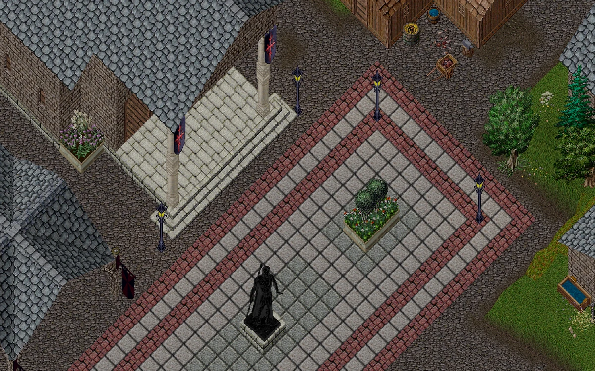 | 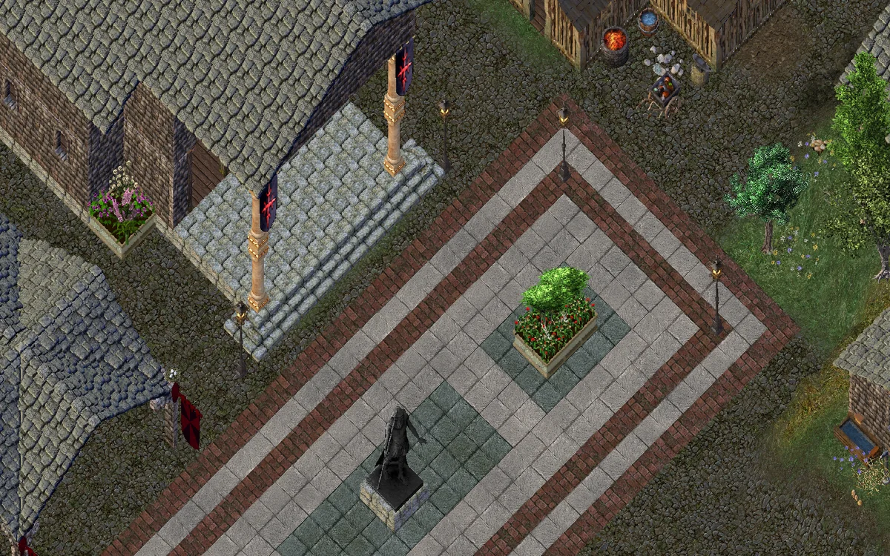 |
| Classic art and terrain | Enhanced art and terrain |

| KR-like | UOD-Painterly |
| --- | --- |
| 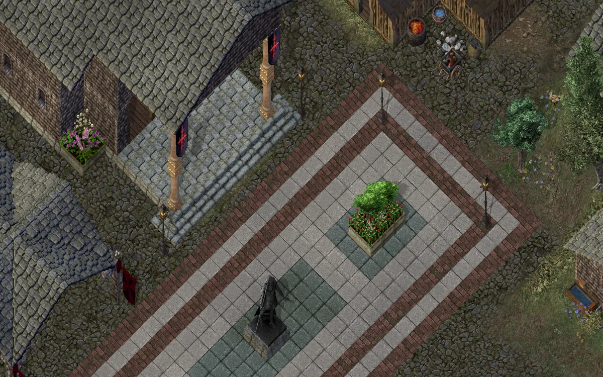 | 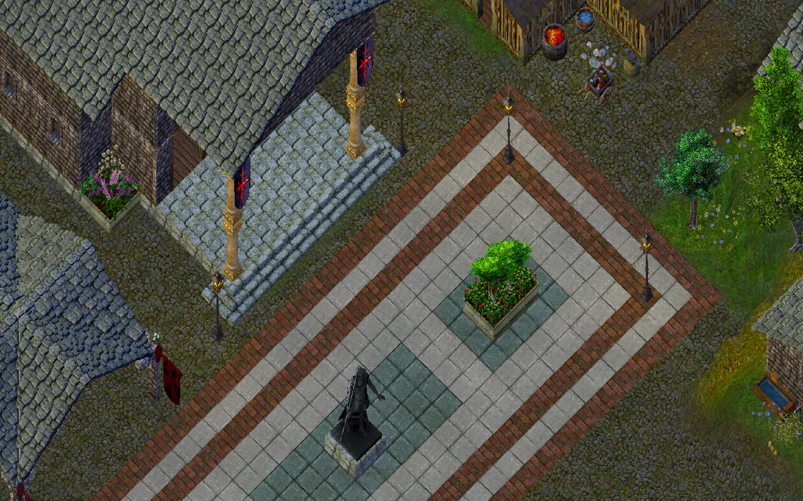 |
| Enhanced art, Kingdom Reborn terrain | Enhanced art and terrain |

**Classic art also works with Enhanced and KR terrain.** Keep Classic buildings, trees, and other world sprites while changing the ground beneath them. [See the matching views and source settings](docs/SHOWCASE.md#mixing-classic-art-with-enhanced-and-kr-terrain).

[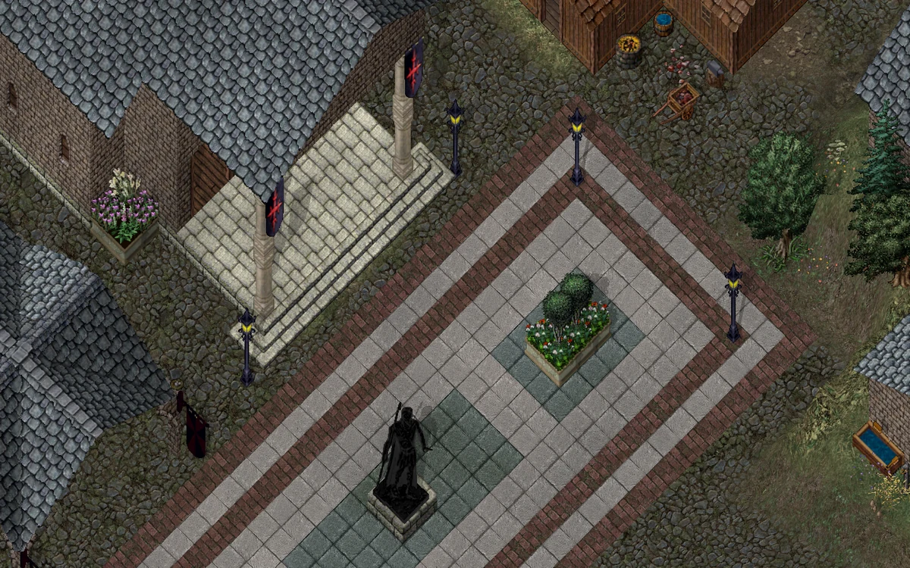](docs/SHOWCASE.md#mixing-classic-art-with-enhanced-and-kr-terrain)

## Creature animation and upscaling

| [Neural frame interpolation](docs/SHOWCASE.md#rife-frame-interpolation) | [Measured strides](docs/SHOWCASE.md#animation-timing-and-measured-strides) |
| --- | --- |
| 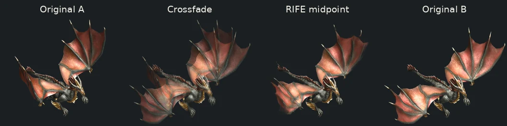 | 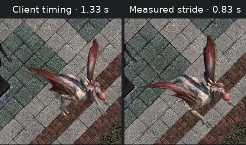 |

**RIFE generates new poses between the original sprite frames.** The default shader crossfade softens pose changes. RIFE ×2 and ×4 use a neural model to estimate how the sprite moves and generate one or three new frames per gap. Dynamapper embeds the model weights and a compact inference engine built on wgpu compute shaders. The new frames are made on demand and add no data to the animation packages.

**Measured strides reduce foot sliding.** A walk or run cycle can match the distance the creature actually moves. Client timing remains selectable and applies when a clip has no matching measurement. Riders and mounts share a cycle paced by the mount, and creature bodies follow slopes, stairs, and bridges. [Watch the side-by-side loop](docs/SHOWCASE.md#animation-timing-and-measured-strides).

**Preview and pack upscaled sprites.** Compare filters on original animation frames in the editor, then use ordered upscaling profiles when building runtime packages. [Upscaling comparisons](docs/SHOWCASE.md#sprite-upscaling).

[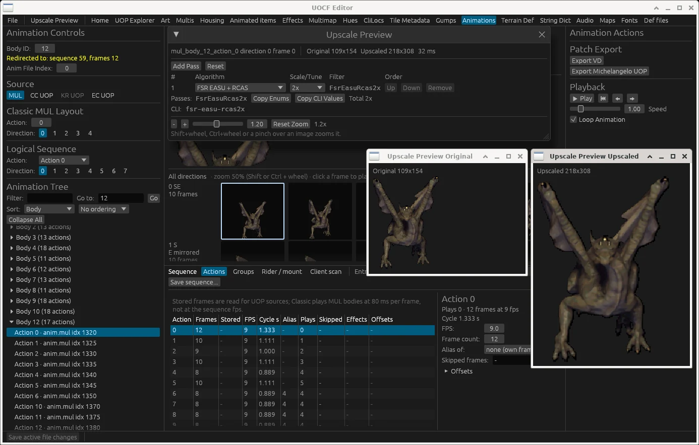](docs/SHOWCASE.md#sprite-upscaling)

## World rendering and exploration

| [Cave entrances](docs/SHOWCASE.md#cave-entrances) | [Floor and room views](docs/SHOWCASE.md#floor-and-room-views) |
| --- | --- |
| 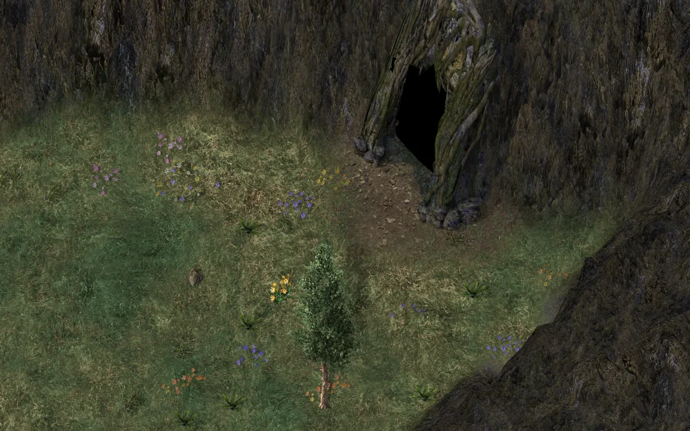 | 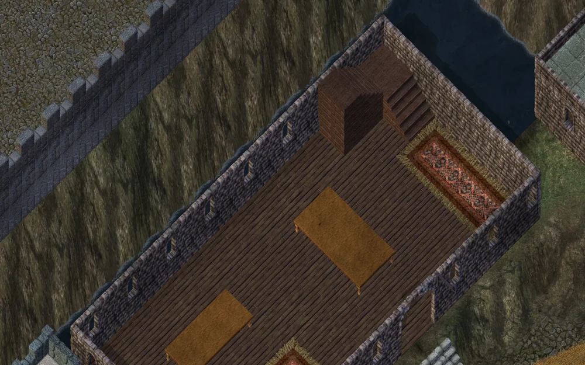 |

| [Zoom range](docs/SHOWCASE.md#zoom-range) | [Paperdolls](docs/SHOWCASE.md#paperdolls) | [Live settings](docs/SHOWCASE.md#live-settings) |
| --- | --- | --- |
| 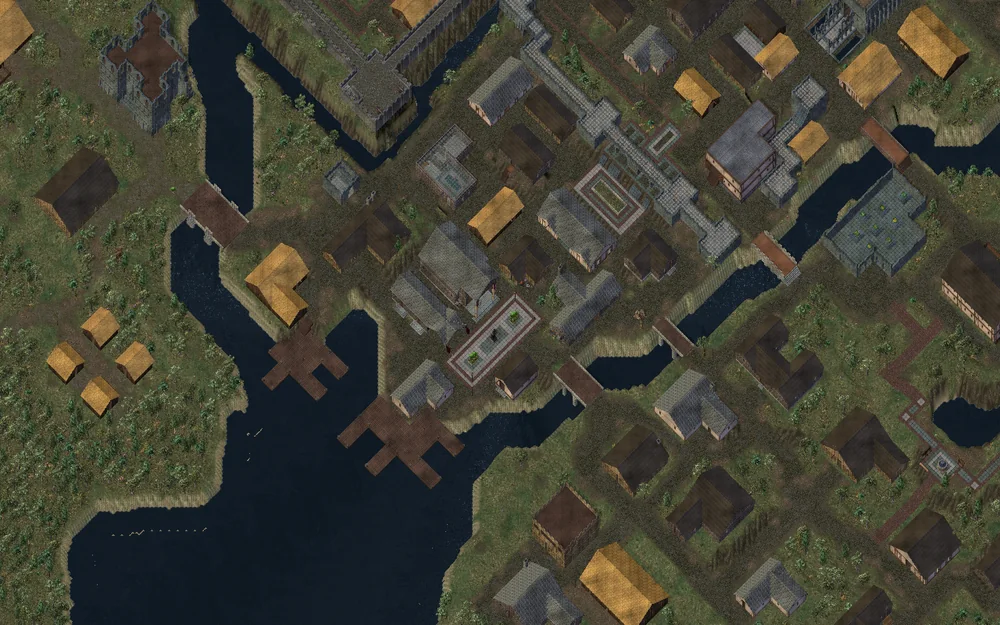 | 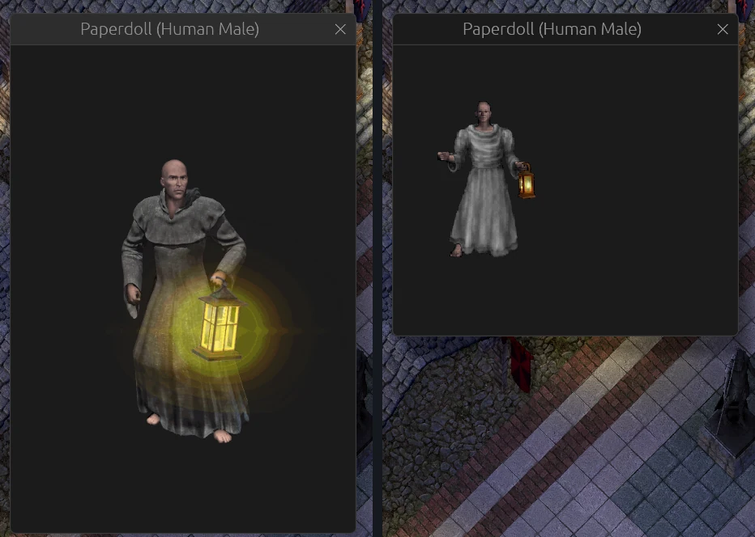 | 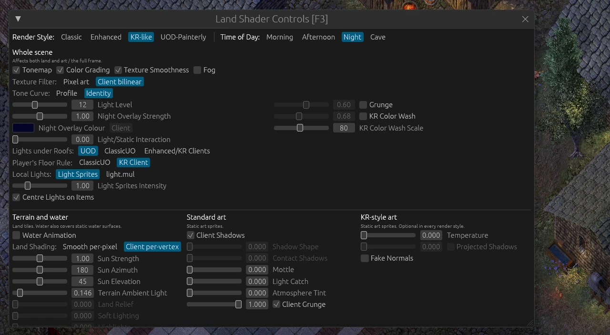 |

Explore with orthographic or free perspective cameras, pick visible map objects, or reveal the player's floor while keeping nearby roofs and their lights visible. Floors and roofs can clip a glow while doors and windows still let light out. The shader panel saves edits per style and time of day. The paperdoll lets you preview equipment and hues and override what a robe covers. Dynamapper loads map chunks in the background and streams texture pages as the scene needs them.

## Asset tools and web export

The workspace ships graphical and command-line tools for original Classic, Enhanced, and Kingdom Reborn client files, alongside tools for packing, inspecting, and editing UDDP packages. The renderer can also export regions as a WebP tile pyramid with a Leaflet viewer. [Tools showcase and guide](tools/README.md) · [Web export validation](docs/reviews/2026-11-01-webmap-export-renderer.md).

## Documentation

- [Dynamapper screenshot showcase](docs/SHOWCASE.md)
- [First-time developer setup](docs/DEVELOPER_SETUP.md)
- [UOCF library guide](lib/uocf/README.md) — client-file format support and library documentation.
- [Asset pipeline](docs/dev_wiki/ASSET_PIPELINE.md) — conversion and package workflows.
- [UDDP formats](docs/dev_wiki/UDDP_FORMATS.md) — package architecture and layouts.
- [Workspace components](docs/dev_wiki/WORKSPACE_COMPONENTS.md) — libraries and tools.
- [Engineering guide](ENGINEERING.md) — contributor guidance.
- [Roadmap](docs/TODO.md)

## License and credits

Released under the [Apache license](LICENSE). See [credits and references](CREDITS.md) for UO file-format and algorithm sources.
