# Dynamapper showcase

[Quick start](../README.md#quick-start) · [Tools showcase](../tools/README.md)

## Britain in four render styles

The afternoon captures use the same position and camera on Trammel. Art and land are listed separately because changing a render preset leaves both source settings in place.

| Classic | Enhanced |
| --- | --- |
| 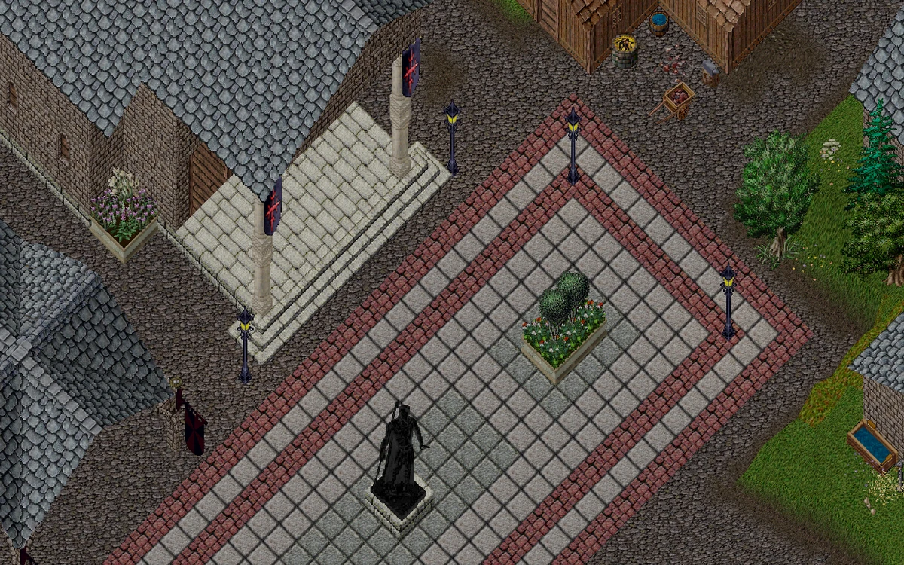 | 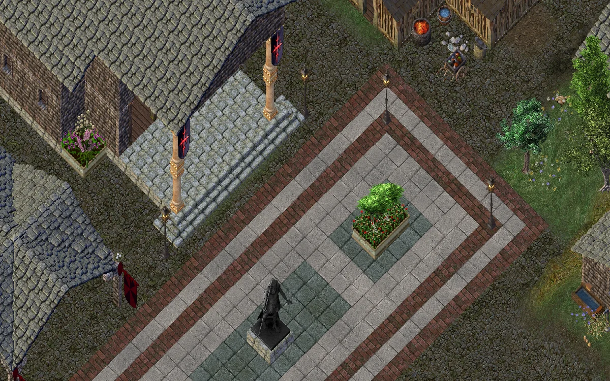 |
| Classic art and terrain | Enhanced art and terrain |

| KR-like | UOD-Painterly |
| --- | --- |
| 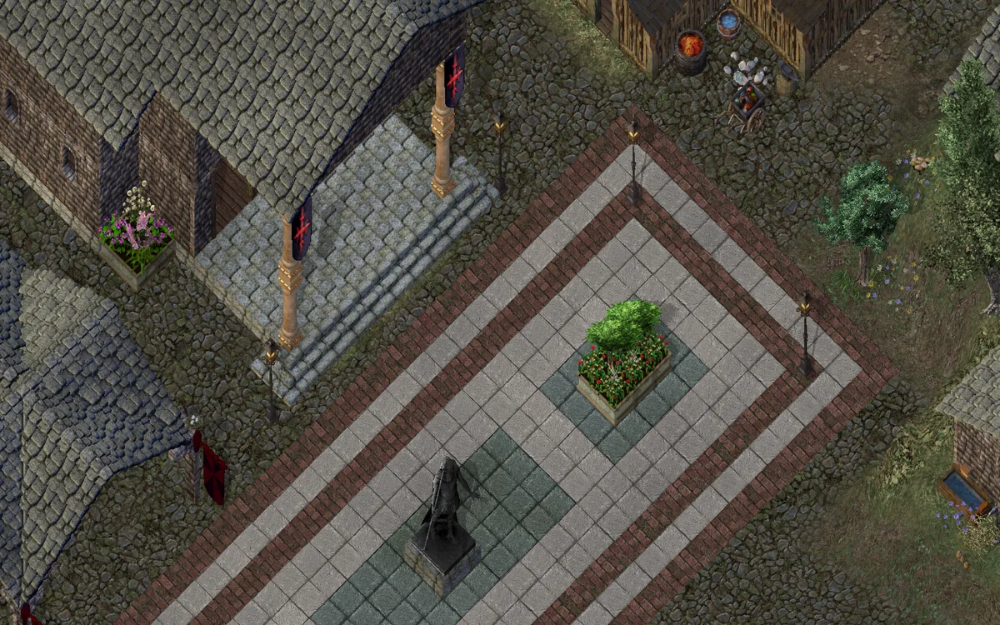 | 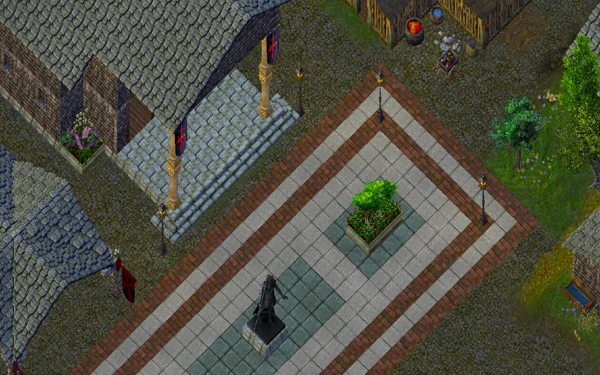 |
| Enhanced art, Kingdom Reborn terrain | Enhanced art and terrain |

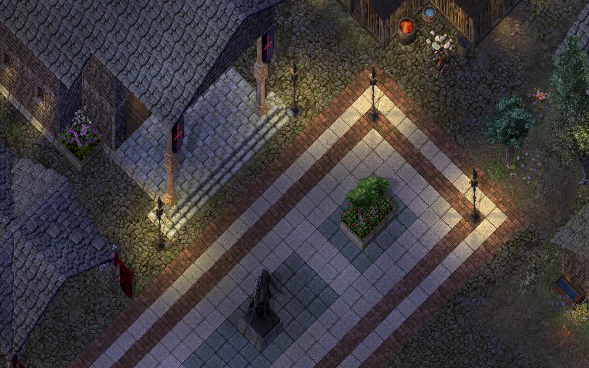

KR-like night lighting in Britain. [Render style rules](dev_wiki/rendering/STYLE_RULES.md) · [Lighting and shadow research](dev_wiki/rendering/CLIENT_NIGHT_LIGHTING_AND_SHADOWS.md)

## Mixing Classic art with Enhanced and KR terrain

Each pair keeps the style, terrain source, and camera fixed. Compare the statue, stairs, and tree to see what changes when you select Classic art.

| Enhanced art and Enhanced terrain | Classic art and Enhanced terrain |
| --- | --- |
|  | 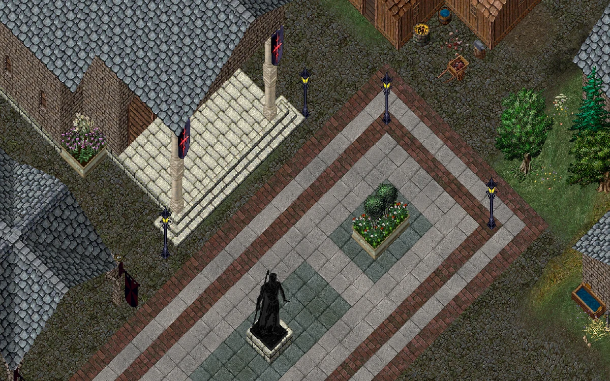 |

| Enhanced art and Kingdom Reborn terrain | Classic art and Kingdom Reborn terrain |
| --- | --- |
|  | 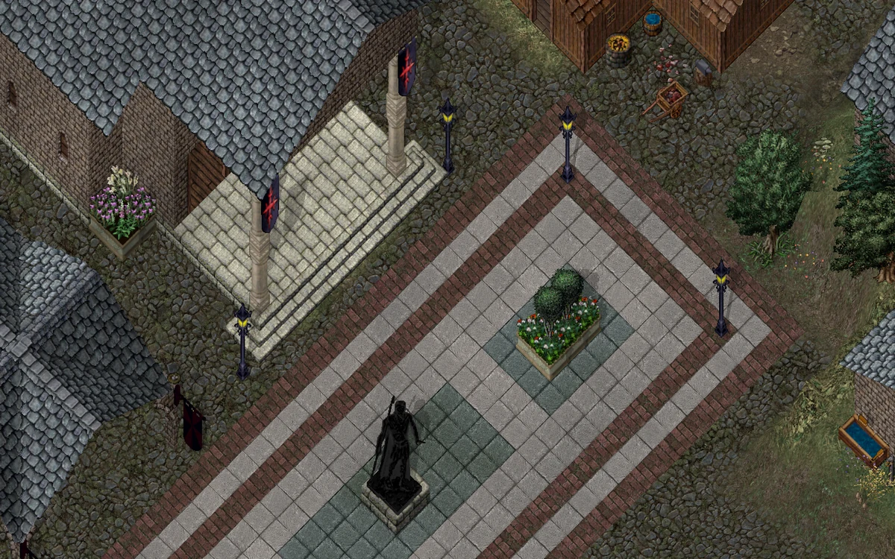 |
| 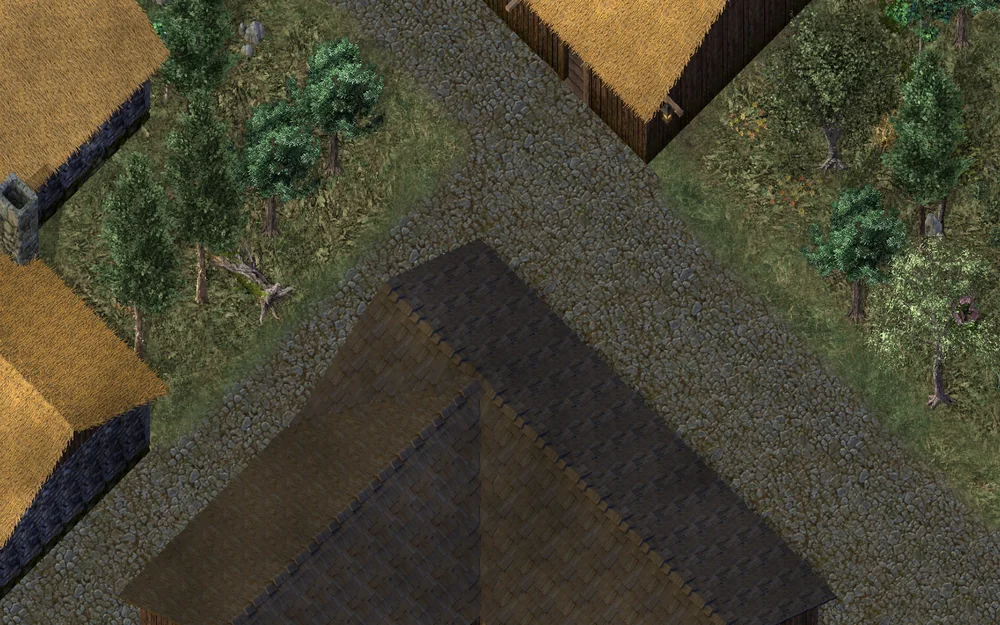 | 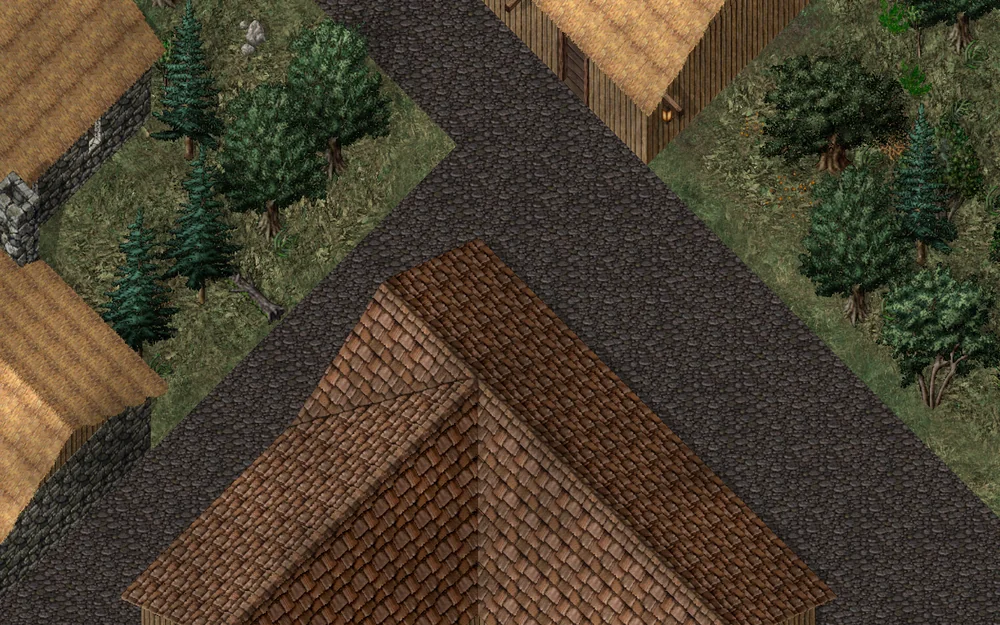 |

Open **F2 → Graphics** to select **Art Texture Source** and **Land Texture Source**. World objects that continue the ground, such as grass and liquids, can take their material and art from the selected terrain source. [Art and terrain source rules](dev_wiki/rendering/STYLE_RULES.md#sources-are-not-part-of-the-style)

## Local lighting after dark

| Lantern by the Minoc mine | Braziers in the hedge maze |
| --- | --- |
| 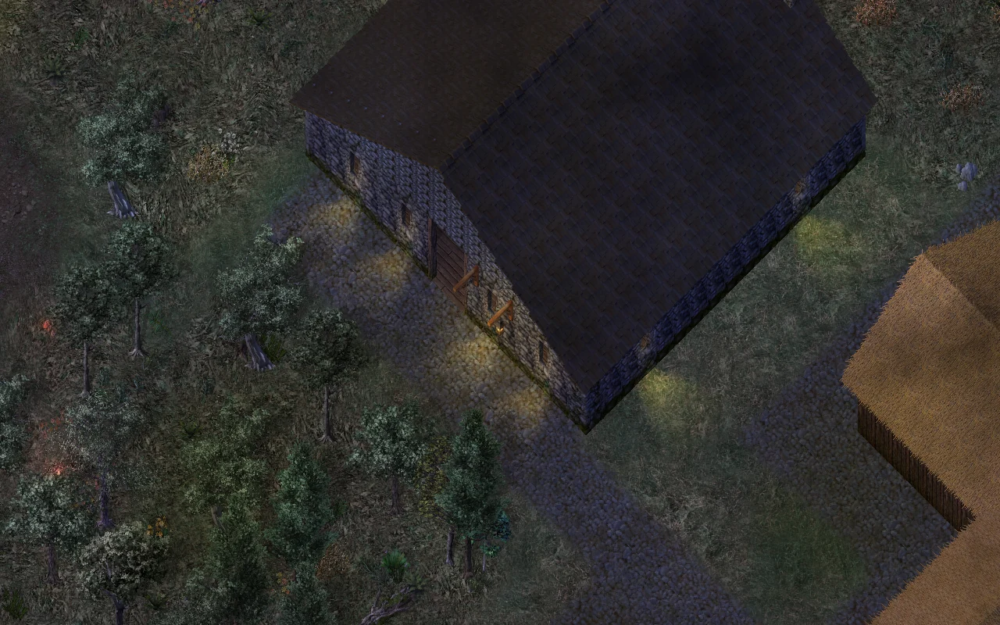 | 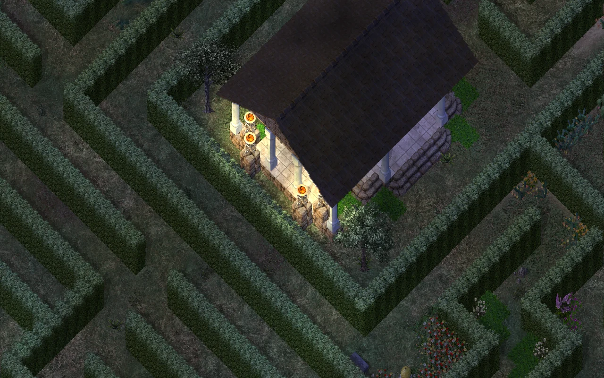 |
| 2507, 560 | 1072, 2269 |

| Lava channel | Lit windows |
| --- | --- |
| 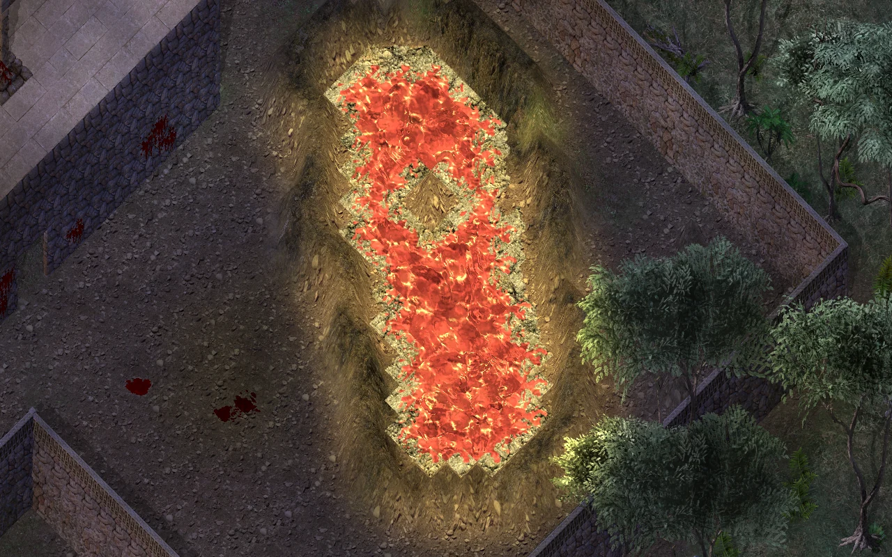 | 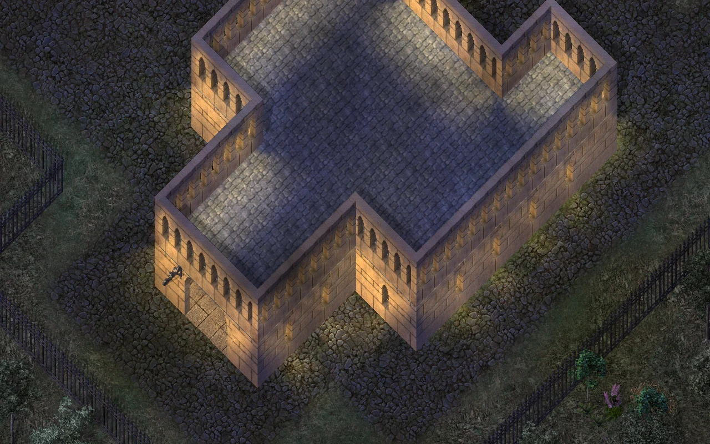 |
| 4622, 3560 | 4475, 1167 |

*Felucca in KR-like night lighting, with Enhanced art, Kingdom Reborn terrain, and optional local lighting enabled.*

The mine lantern lights the path and wall under the eave. The braziers pool light across the columns and paving, while the lava lights the rocks along its banks. In KR-like and Enhanced styles, **F3 → Local Lights** lets you choose between light sprites and `light.mul` and adjust the selected source's intensity. [Night lighting and light cover](dev_wiki/rendering/CLIENT_NIGHT_LIGHTING_AND_SHADOWS.md)

## RIFE frame interpolation

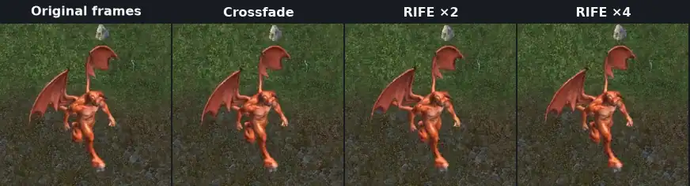

This five-second comparison shows an Enhanced daemon walking east across Trammel. All four Dynamapper recordings use the same route, zoom, client timing, and ground speed. **Original frames** holds each sprite pose until the next one. **Crossfade** blends neighboring poses. **RIFE ×2** and **RIFE ×4** generate one and three intermediate poses per frame pair. Watch the wings and feet during each step.

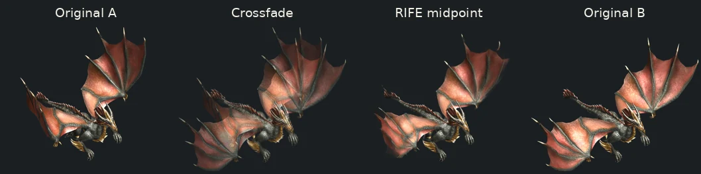

The two source frames are on the outside. In the middle, the crossfade blends the two wing outlines while RIFE estimates an intermediate pose. Dynamapper runs RIFE on the GPU and generates one or three in-between frames per pair in the ×2 and ×4 modes. The strip is from the offline RIFE comparison used during development.

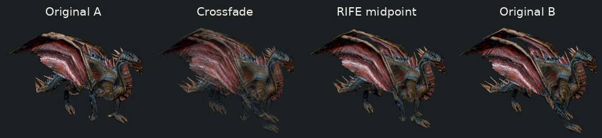

The same comparison on a Classic wyrm. Look at the near wing and feet.

See the [animation development notes](agent_notes/mobile_animation_motion.md) for the GPU inference and playback implementation.

## Animation timing and measured strides

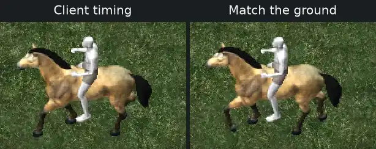

An Enhanced rider and horse take the same walk across Trammel. **Client timing** plays the original animation cadence. **Match the ground** paces both animations using the mount's measured stride. Watch the hooves against the ground as it scrolls by.

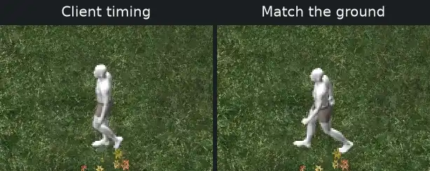

The same comparison on foot. The ground moves at the same speed in both panels. Follow the Enhanced human's planted foot to see the change in cadence.

[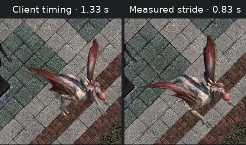](images/showcase/anim-stride-wyrm-loop.webp)

Open the [animated side-by-side comparison](images/showcase/anim-stride-wyrm-loop.webp) and follow the feet against the paving. Both panels move over the ground at the same speed. The Enhanced wyrm uses a 1.33-second cycle at client timing and a 0.83-second cycle with the measured stride in this development comparison. The renderer uses a matching stride measurement from the animation package when available.

## Sprite upscaling

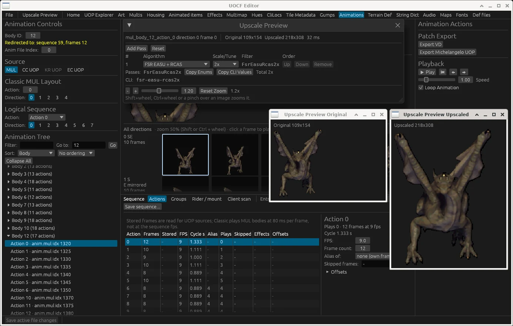

The graphical editor previews upscale passes on animation frames. Image packers support ordered upscale profiles for Classic and Enhanced animation frames, gumps, terrain textures and art. See the [upscale profile guide](../tools/udd-conv-cli/README.md#upscale-profiles).

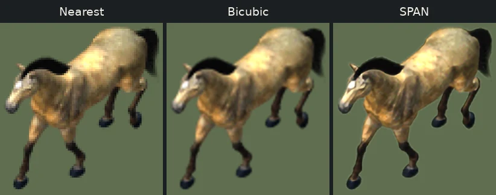

An offline 4× comparison on an Enhanced horse frame. Dynamapper also offers **SPAN 2×** in its graphics options. It runs on the GPU for Enhanced animations at close zoom, including RIFE in-betweens. [Runtime animation and upscaling notes](agent_notes/mobile_animation_motion.md#span-2-in-game-mobile_upscale-2026-11-21)

## Cave entrances

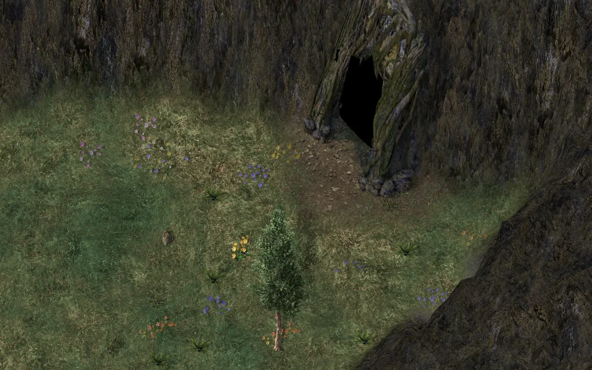

North of Britain, the cave arch meets the hillside. From inside, the entrance and the cave floor remain visible, and the outside can be dimmed or drawn in black.

| Dimmed surroundings | Black surroundings |
| --- | --- |
| 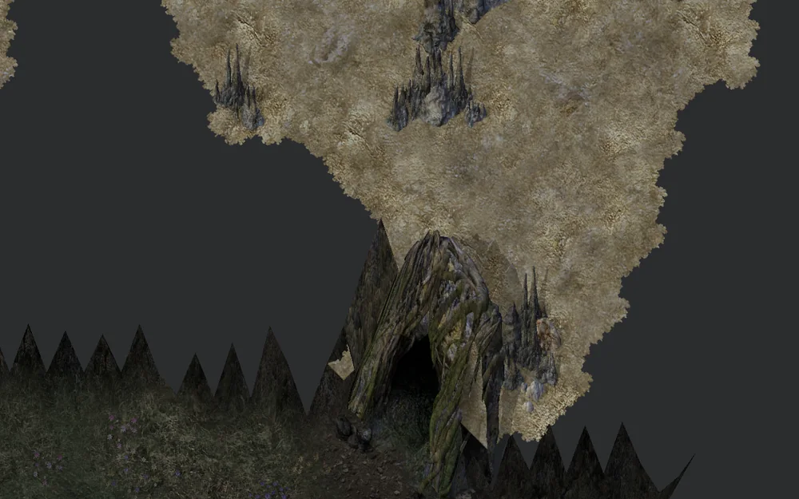 | 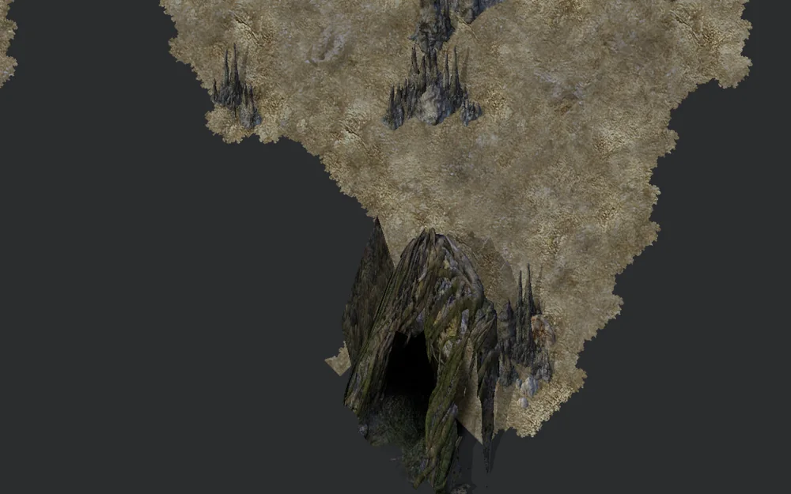 |

See the [cave rendering rules](dev_wiki/rendering/STYLE_RULES.md#caves-every-style).

## Floor and room views

| Roof and upper floors visible | Current building cut away | Cutaway across the view |
| --- | --- | --- |
| 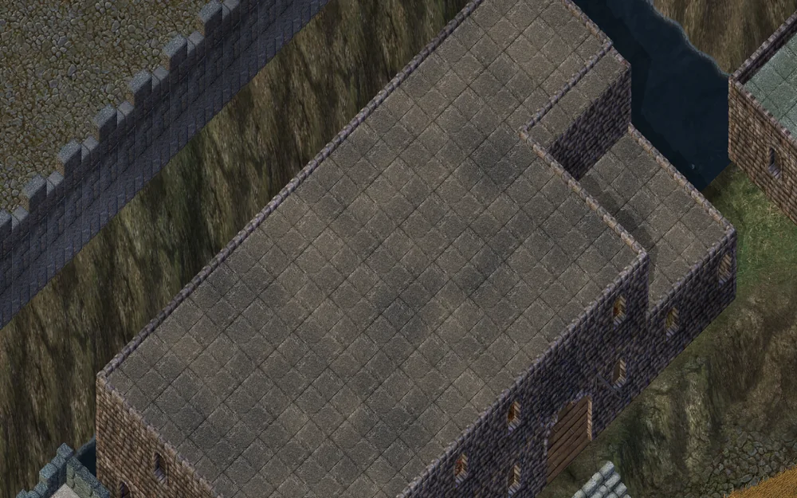 | 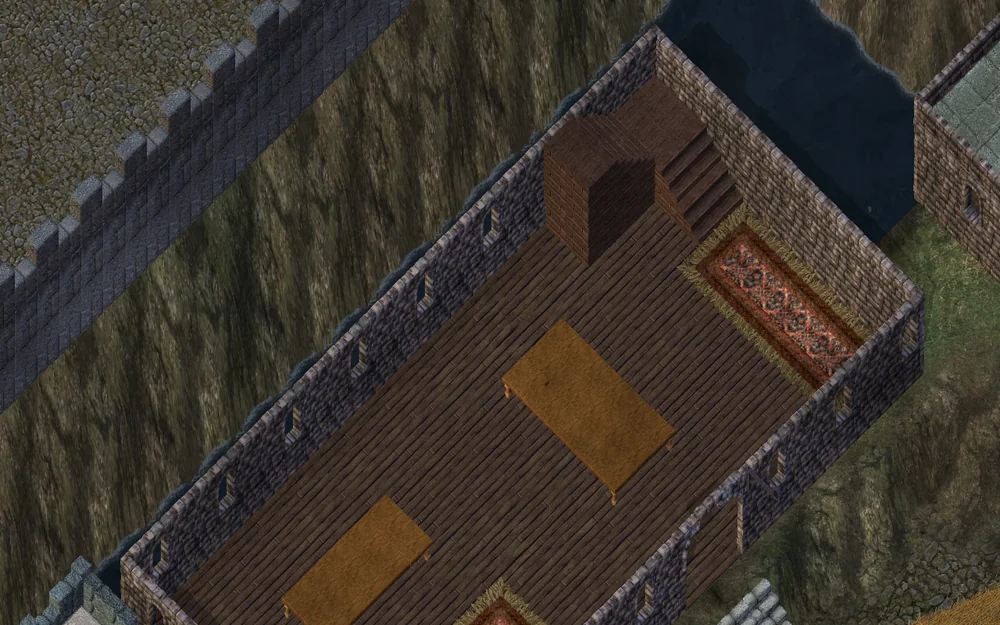 | 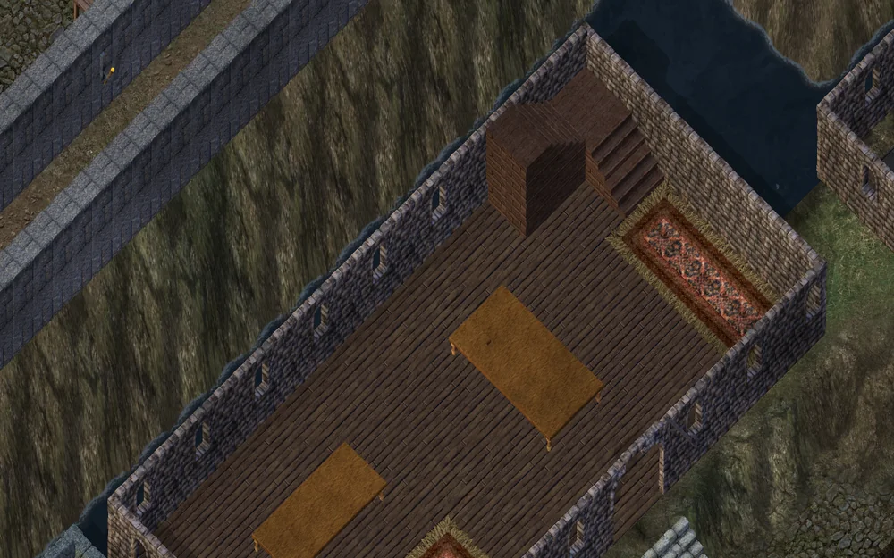 |

In **F2 → Graphics**, enable **Show Only the Player's Floor**. **Only the Player's Building** keeps the cut to the current building so surrounding roofs and their lights can remain. All three captures use the same camera and player position.

## Zoom range

| Close enough to inspect the paving | Wide enough to read the town layout |
| --- | --- |
| 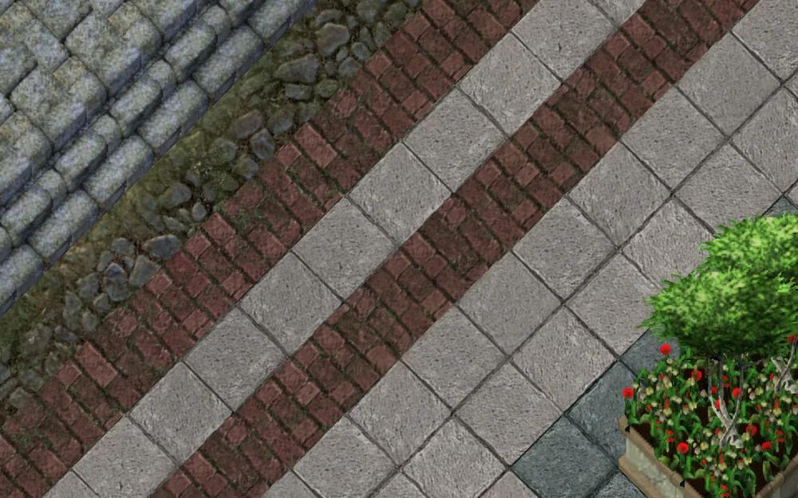 | 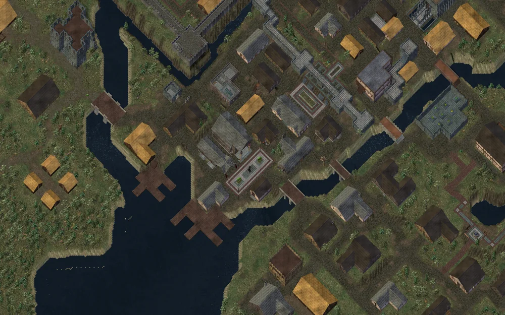 |

Both captures are centered on the same point in Britain. The wide view covers 32 times as much world width as the close view.

At scale 20 and wider, ordinary statics use packed radar colors. River and shoreline water keep their liquid materials, with foam and transparent edges filtered as the view zooms out.

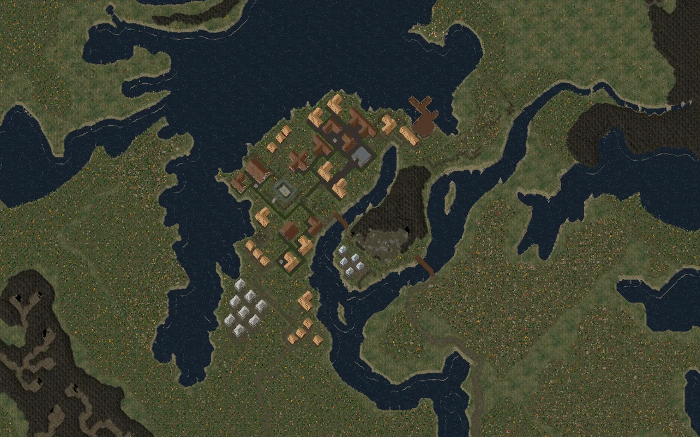

*Minoc at scale 20 with Enhanced art and Kingdom Reborn terrain.*

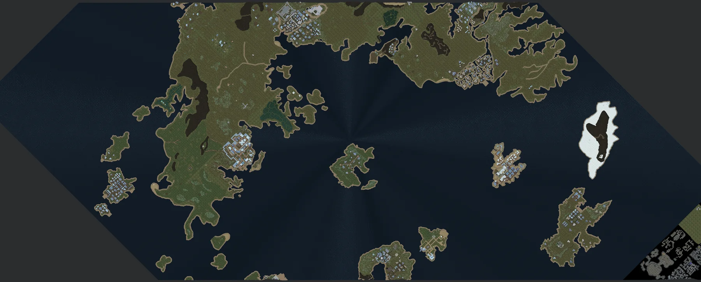

*Trammel at scale 50 in KR-like style. This live view covers more than half of the mainland bounds.*

[View the full Trammel facet as a radar export](images/showcase/world-trammel-radar.webp). The converter builds this top-down image from the map and its statics.

## Paperdolls

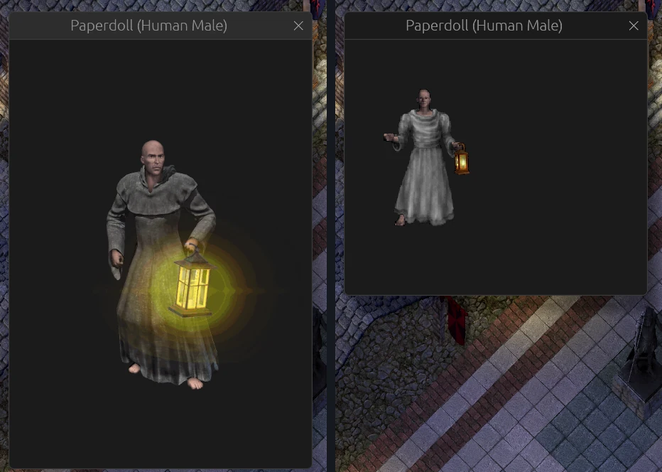

The same outfit in both Enhanced paperdoll modes. The 3D-style frames show the lantern's larger glow. Pack the gump and paperdoll data and set `load_gumps = true` in `assets/settings/runtime_assets.toml` before launching. Press **Ctrl+U** and select **Paperdoll** to preview equipment and hues. The paperdoll's context menu lets you override garment coverage for a robe.

## Live settings

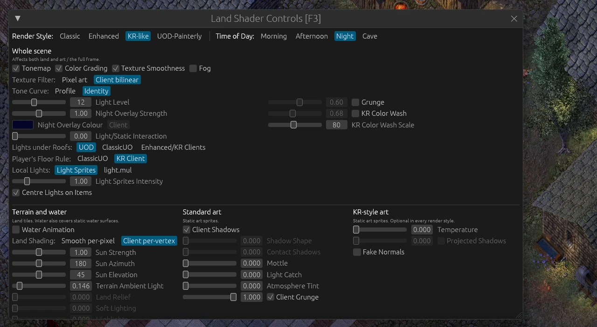

Open Land Shader Controls with **F3** to switch styles and times of day, and tune lighting and materials for the active preset.

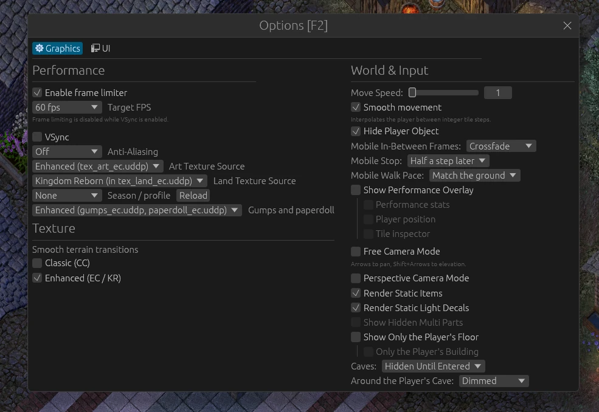

Open Options with **F2** to select art and terrain independently and adjust animation, camera, and visibility settings.
