# Ultima Online tools

The UOClientFiles library and tools read, edit, and convert original **Classic**, **Enhanced**, and **Kingdom Reborn** client files. The UDD tools build and maintain the **UDDP packages** that Dynamapper streams. You can use the client-file tools independently of the renderer.

Download the platform's `-tools` artifact from a successful **Build Release** run. Unpack it and run the programs in `UODynamapper-tools/bin/`, with the bundled `shared/` folder in place. Use the help flag on any CLI to see its commands. [Build downloads](https://github.com/cbnolok/UODynamapper/actions/workflows/release.yml) · [Build from source](../docs/DEVELOPER_SETUP.md) · [Dynamapper showcase](../docs/SHOWCASE.md)

## Inspect and edit client assets

**UOCF Editor** can preview multis with a different client's art, inspect facets, and browse tile metadata, gumps, hues, fonts, audio, and localized strings. Edit supported tile flags, terrain material definitions, multi parts, animated item records, palette entries, and font glyphs, then save copies of the changed client files. Bulk image exports run in the background. Classic art and frame exports preserve original pixel values or palette indices in the formats that support them. [Editor views](uocf-editor-gui/README.md#views) · [Image export formats](uocf-editor-gui/README.md#image-export)

| Classic multi with Kingdom Reborn art | Enhanced tileart editing |
| --- | --- |
| [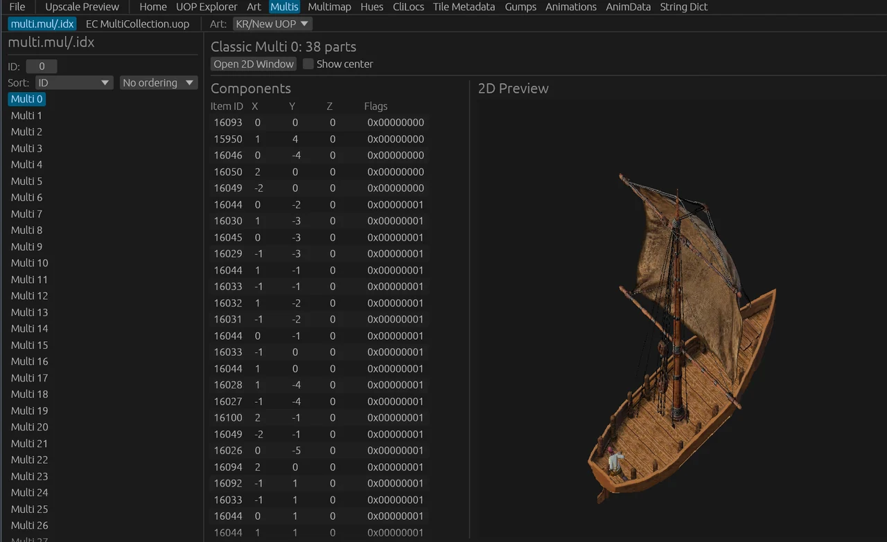](uocf-editor-gui/README.md) |  |

**Animation Sequence inspector.** Preview creature clips at client timing, inspect and edit action aliases, frame counts, timing, and skipped frames, and compare rider and mount cycles. The editor and `uocf-cli sequence scan` can both check client sequences against their stored frames. The frame tools also export and replace sprite frames and preview upscaling. [Animation sequence guide](uocf-editor-gui/README.md#animation-sequences) · [Sprite upscaling examples](../docs/SHOWCASE.md#sprite-upscaling)

**Enhanced and KR effects.** Browse and edit effect definitions and resources, inspect particle components and textures, and play a preview with the selected effect's parts. Supported effect previews can be exported to glTF. [Graphical editor guide](uocf-editor-gui/README.md)

Client archives, multi parts, palettes, and strings

| Explore a UOP archive | Enhanced multi with Classic sprites |
| --- | --- |
| Browse the archive tree and preview a world art sprite. | Inspect a ship's component parts with Classic art selected. |
| [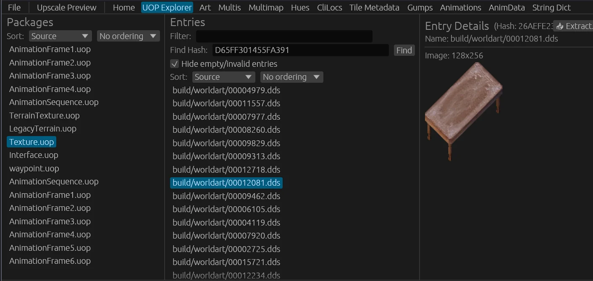](docs/images/tool-uop-explorer.webp) | [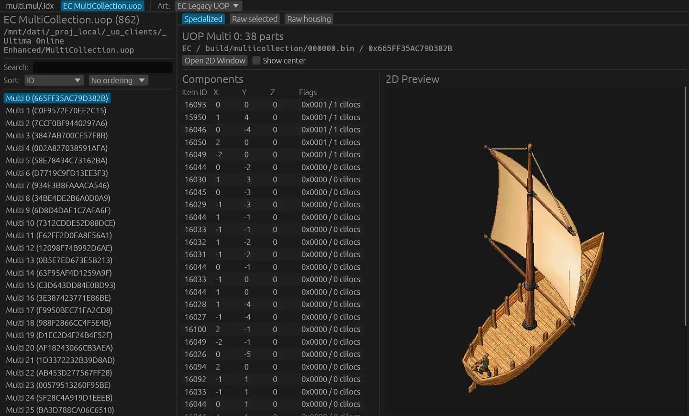](docs/images/tool-enhanced-multi-classic-art.webp) |

| Classic hue palettes | Enhanced localized strings |
| --- | --- |
| Inspect a hue ramp and see how it applies to a sprite. | Look up localized entries by ID or text. |
| [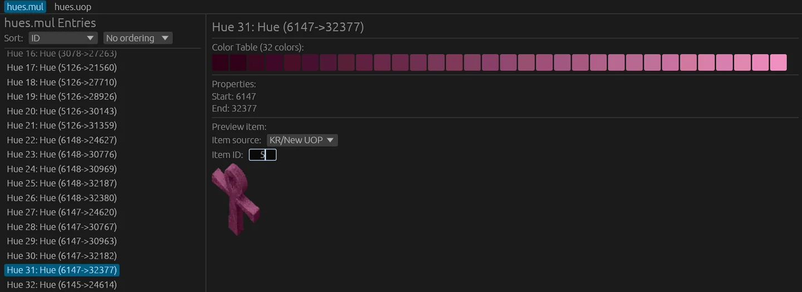](docs/images/tool-classic-hues.webp) | [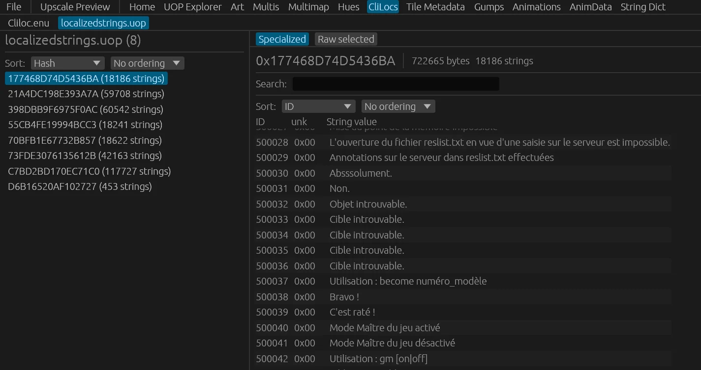](docs/images/tool-enhanced-strings.webp) |

Creature frames, animation timing, upscaling, and effects

| Classic UOP creature animation | Enhanced Animation Sequence |
| --- | --- |
| Browse creature bodies, actions, and directions with a frame preview. | Inspect client action aliases and frame timing alongside the sprite. |
|  |  |

| Animation upscaling | Particle effects |
| --- | --- |
| Compare a Classic creature frame at native and upscaled resolution. | Play an Enhanced fireworks effect and inspect its particle parts and diagnostics. |
| [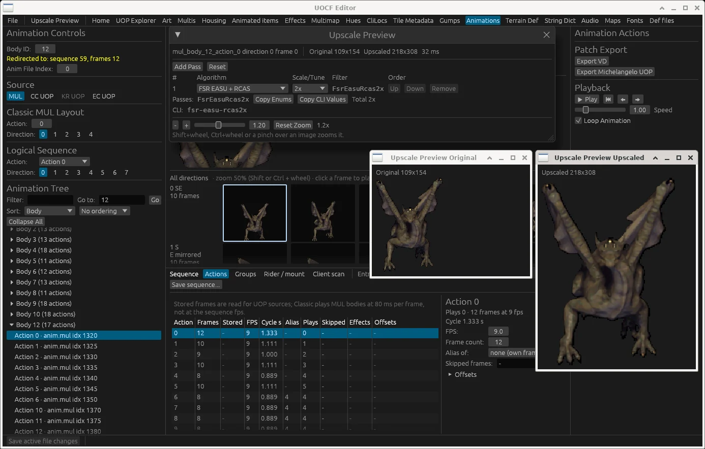](../docs/images/showcase/anim-upscale-editor.webp) |  |

**`uocf-cli`** converts facets among Classic, Enhanced, and Kingdom Reborn, converts supported MUL/IDX and UOP assets, and round-trips Classic and Enhanced hue palettes. It can also patch a single Classic map cell or export and import a Classic animation action with its frame anchors and palette data. [CLI guide](uocf-cli/README.md) · [UOCF library guide](../lib/uocf/README.md)

These workflows overlap with UOFiddler, MulPatcher, LegacyMULConverter-N, UOETE, UOEMC, huesmul2uop, and UOPTool. The editor guide gives the supported operations for each format, including views that are inspection-only.

## Build, inspect, and edit UDDP packages

**Quick Convert** is the converter's opening page. Build packages from your configured Classic or Enhanced clients with BC1 or BC7 where supported, Zstd or adaptive LZ4, and no upscaling or filters. [Quick Convert guide](udd-conv-gui/README.md#quick-convert)

- **Build runtime packages** with `udd-conv-gui` or `udd-cli pack`. Convert maps and statics, texture atlases, creature animations, user interface assets, and metadata. Choose compression and upscaling for supported assets. Enhanced packages can include Kingdom Reborn terrain and material sections. [Converter guide](udd-conv-gui/README.md) · [Asset pipeline](../docs/dev_wiki/ASSET_PIPELINE.md)
- **Inspect converted data** with `uddp-inspector-gui`. Browse raw entries and virtual texture or material slots, inspect atlas pages and gumps, and preview packaged creature animations and effects. Export images as BMP, PNG, or WebP, or extract the bytes as stored in the package. [Inspector guide and screenshots](uddp-inspector-gui/README.md)
- **Edit or check a package** with `udd-cli tool`. Extract or replace an entry, round-trip supported metadata as CSV, compare packages, and validate rebuilt files. The stride tools measure movement cycles on the GPU and export, import, or check the measurements used for ground-matched movement. [Package commands](udd-conv-cli/README.md#udd-cli-tool)

Quick Convert results and per-package settings

| Quick Convert completed | Asset Converter settings |
| --- | --- |
| Quick Convert reports completion after building 26 packages from both clients. | Set texture codecs, package compression, and upscale profiles for individual conversion jobs. |
| [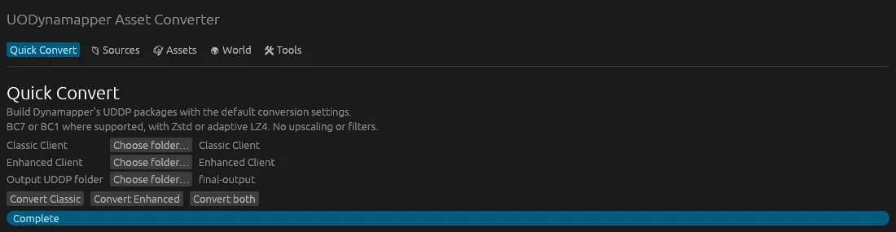](docs/images/tool-quick-convert-results.webp) | [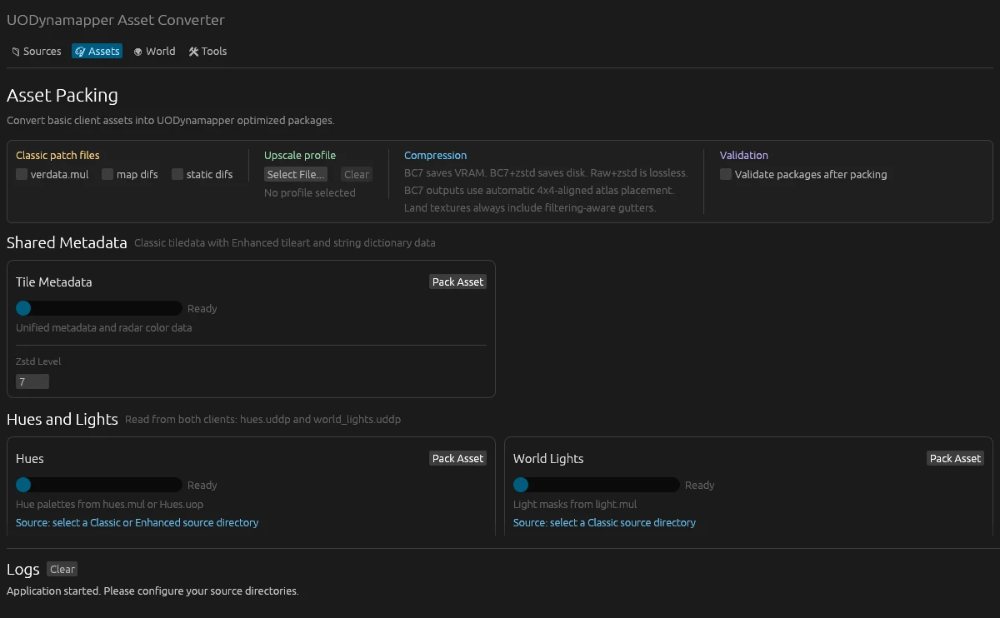](docs/images/tool-converter-assets.webp) |

Packaged textures, gumps, animations, and effects

| Classic terrain texture | Enhanced texture entries |
| --- | --- |
| Look up a Classic terrain tile by ID and see its atlas page and pixel rectangle. | Browse Enhanced texture entries and preview the selected texture. |
| [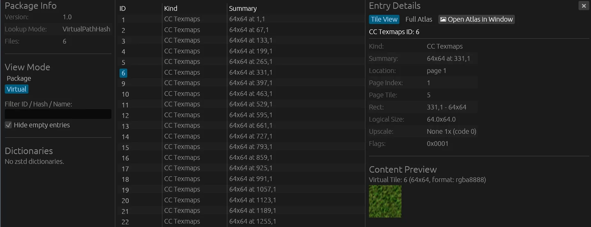](docs/images/tool-uddp-classic-atlas.webp) | [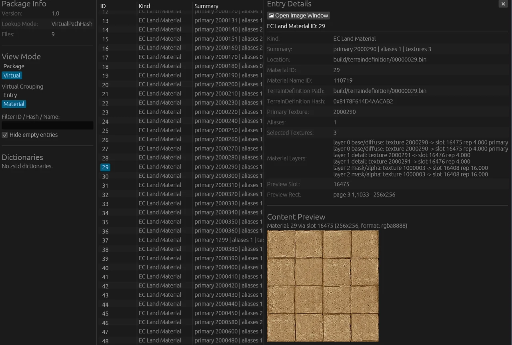](docs/images/tool-uddp-texture-inspector.webp) |

| Classic creature animation | Classic gumps |
| --- | --- |
| Play a packaged creature clip and inspect its frame and atlas metadata. | Select a gump by ID in Virtual mode to preview it and see how it is stored. |
| [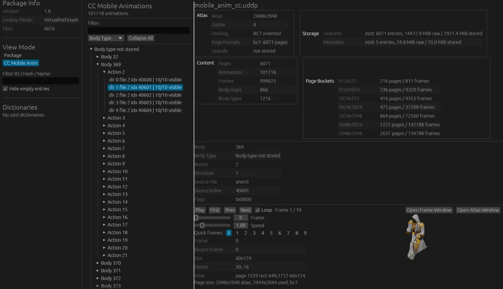](docs/images/tool-uddp-animation-inspector.webp) | [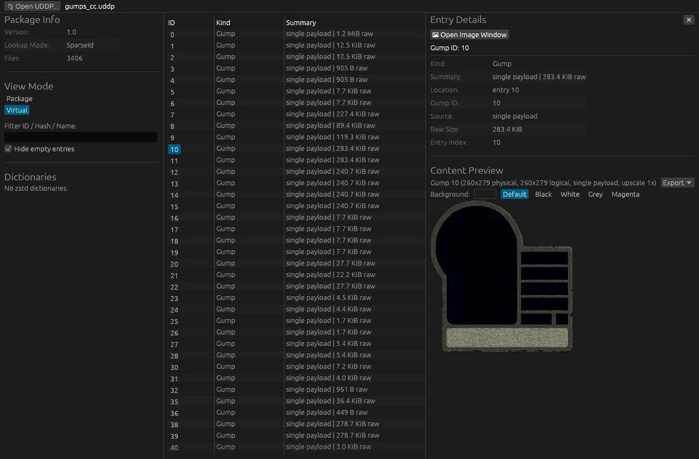](docs/images/tool-uddp-classic-gumps.webp) |

Preview an Enhanced fire texture at a selected mip level and see which particle effects use it. The other tabs list definitions, sequence frames, and particle systems.

[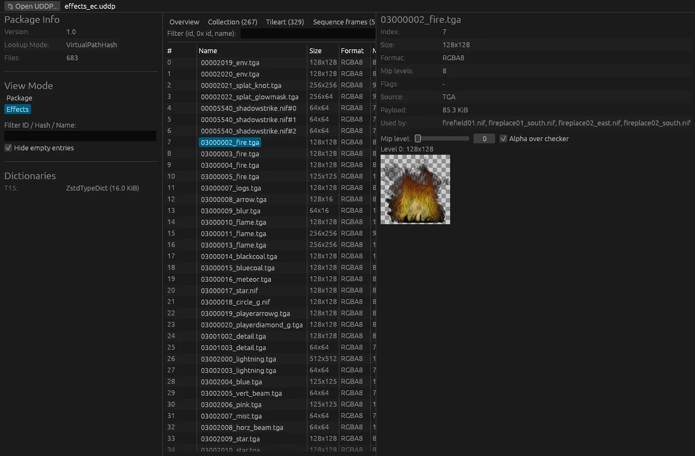](docs/images/tool-uddp-effects.webp)

## Web map export

`webmap-export-cli` renders a region through Dynamapper and produces a WebP tile pyramid and a Leaflet viewer. Use `webmap-export-cli --help` for the available commands. [Export examples and validation limits](../docs/reviews/2026-11-01-webmap-export-renderer.md)

## Tool index

| Task | Tool | Starting point |
| --- | --- | --- |
| Inspect and edit supported client assets | `uocf-editor-gui` | [Editor guide](uocf-editor-gui/README.md) |
| Convert client formats and inspect animation sequences | `uocf-cli` | [CLI guide](uocf-cli/README.md) |
| Inspect, extract, replace, or rebuild a UOP package | `uoppackage-cli` | `uoppackage-cli --help` |
| Resolve hashed paths and expand UOP dictionaries | `uop-dict-populator-gui` | [Dictionary tool guide](uop-dict-populator-gui/README.md) |
| Patch supported client executable settings, such as facet sizes and login servers | `uo-client-patcher-gui` | [Client patcher guide](uo-client-patcher-gui/docs/README.md) |
| Build runtime packages | `udd-conv-gui`, `udd-cli pack` | [Converter GUI](udd-conv-gui/README.md) · [Packing commands](udd-conv-cli/README.md#udd-cli-pack) |
| Inspect or edit converted packages | `uddp-inspector-gui`, `udd-cli tool` | [Inspector](uddp-inspector-gui/README.md) · [Package commands](udd-conv-cli/README.md#udd-cli-tool) |
| Export rendered web maps | `webmap-export-cli` | [Web map export](#web-map-export) |

`uocf-devtools-cli` and `udd-devtools-cli` provide research and diagnostics. Their optional binaries require the `dev-tool-tests` feature. [UDD development tools](udd-devtools-cli/README.md) · [Workspace components](../docs/dev_wiki/WORKSPACE_COMPONENTS.md)
