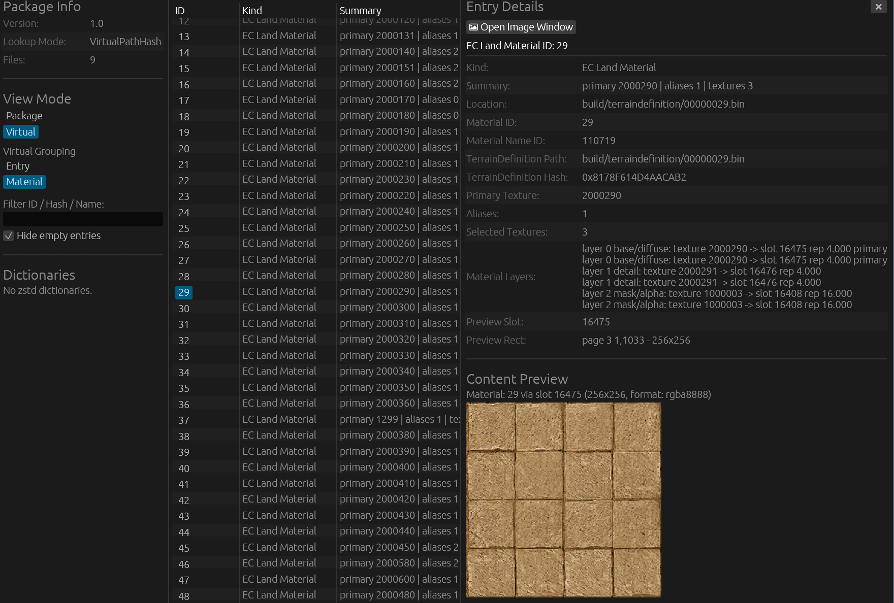
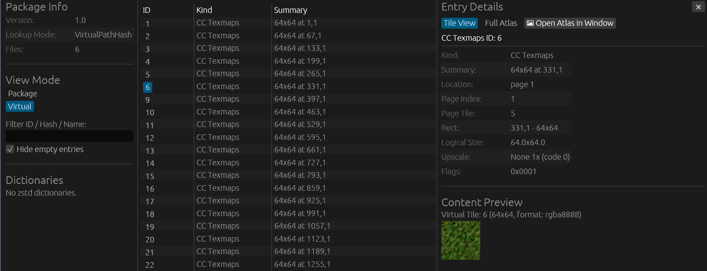
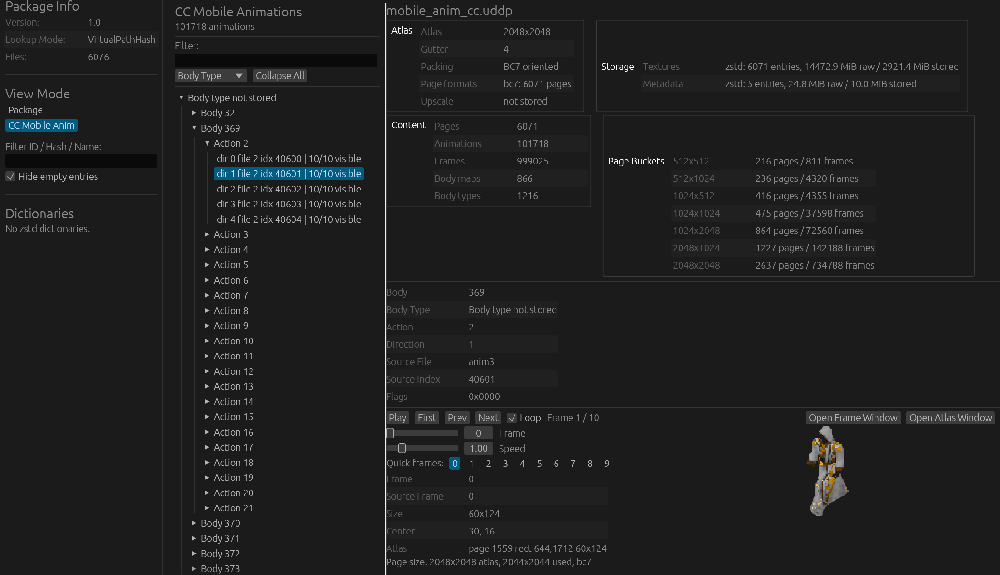

# uddp-inspector-gui

`uddp-inspector-gui` is a graphical inspector for `.uddp` and `.uddpi`
UODynamapper package files. It provides structural browsing, atlas page
visualization, metadata inspection, and mobile animation playback.

## Features

- **Package view**: list all raw entries in a `.uddp` file with their virtual
  paths, sizes, and compression metadata. Select an entry to preview its
  decoded content (textures, binary data).
- **Virtual view**: browse the logical content of packages that expose virtual
  entries (e.g. terrain definition slots, art tile slots). Supports material
  entry and generic virtual entry modes.
- **Atlas page preview**: inspect texture atlas pages, zoom, and review per-page
  metadata.
- **Gump viewer**: load `gumps_cc.uddp` or `gumps_ec.uddp` and browse gump IDs
  as virtual entries, including standalone payloads and paperdoll atlas slots
  with logical size/upscale metadata.
- **Mobile animation playback**: load `mobile_anim_cc.uddp` or
  `mobile_anim_ec.uddp` and play back mobile animation sequences with
  configurable speed and looping.
- **Image export**: the `Export` menu beside a previewed image (an entry or the
  full atlas page) saves it decoded, as shown, to a 32-bit BMP with alpha or a
  lossless PNG or WebP. A BC-coded texture is saved as its decoded, lossy
  pixels; `💾 Extract` saves the stored bytes.

## Binary

```
uddp-inspector-gui
```

## Notes

- Open a `.uddp` file via the file dialog or by passing its path as an argument.
- See [docs/dev_wiki/UDDP_FORMATS.md](../../docs/dev_wiki/UDDP_FORMATS.md) for
  package format details.
- For CLI-based extraction and metadata editing, use
  [`udd-tool`](../udd-conv-cli/README.md) from `udd-conv-cli`.

## Screenshots

### Main View: UDDP Package & Atlas Inspector


<details>
<summary><b>Click to expand individual view screenshots</b></summary>

#### Classic Client Texture Atlas


#### Mobile Animation Playback


</details>

