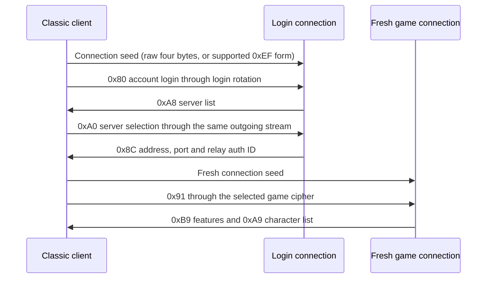

# Client encryption and login handshakes

Enhanced Client and Kingdom Reborn have three independent controls in the GUI and CLI:

| CLI flag | Patch edit | Effect |
|---|---|---|
| `--no-login-encryption` | `ExeEdit::NoLoginEncryption` | Remove the login send cipher only; leave game setup alone |
| `--no-game-encryption` | `ExeEdit::NoGameEncryption` | Remove game cipher transforms only; retain KR's E3/E4 exchange |
| `--bypass-kr-handshake` | `ExeEdit::BypassKrHandshake` | KR only: immediate plaintext game login with Huffman, without E3/E4 |

Scoped flags may be combined. `ExeEdit::NoEncryption` (`exe patch --no-encryption`) retains its existing meaning:
remove login and game ciphers and bypass KR's handshake. It cannot be combined with the scoped flags.
All controls default off and only the selected sites must be located. Traced in
[the UOKR research](research/uokr_login.md),
which also lists every site of every build.

Recognized early Classic clients (the supplied 1.23 through 1.25.36 executables) share one outgoing rotation
cipher between login and game traffic. They expose one **Remove login + game encryption** control, using
`--no-encryption`. Individual `--no-login-encryption` and `--no-game-encryption` requests are refused with a
shared-cipher explanation. There is no KR handshake in these clients. The patch replaces only the two-byte XOR;
queueing and cipher-state updates remain intact. `exe show --crypt-keys` extracts the actual constants and
identifies the old rotation or special 1.25.36 algorithm. These clients send a raw four-byte seed, without 0xEF;
their filenames and absent PE version resources are not used to guess keys. See
[the detailed rotation-cipher reference](research/classic-rotation-cipher.md).

**Coverage correction for original 1.23 and 1.25:** both also have a separate incoming rotation cipher. The
completed shared patch disables their outgoing XOR only; it leaves incoming decryption active. The reported
`removed` state describes the outgoing site currently located by the patcher, and must not be interpreted as
complete plaintext support for those two executables. Their audited receive paths frame decrypted packets
directly, without the later Huffman stage. The supplied 1.25.34–1.25.36 group instead uses Huffman on the game
receive route without that incoming rotation cipher. The algorithms, initialization, exact evidence and remaining
patch requirements are recorded in the cipher reference.

The native login messages also differ: original 1.23 builds a two-byte `91 00` continuation; original 1.25 and the
later supplied builds construct the 65-byte game login. The earlier 65-byte Sphere vectors were constructed
cipher probes, not captures of original 1.23's packet assembly. They validate outgoing rotation and Sphere's
65-byte decoder, rather than original 1.23's complete login. See
[native early Classic login sequences](research/early-classic-login.md) for framing, packet layouts and connection
state, and [Sphere/Classic compatibility](SPHERE_CLASSIC_COMPATIBILITY.md) for current server behavior and remaining work.

These early executables predate the patcher's supported facet tables. They can be inspected and patched for
encryption, and use the Classic configuration-file login destination tools; facet editing and data validation
are unavailable. Later Classic encryption layouts remain unsupported unless their network code matches a
validated early layout.

## EC/KR transforms and connection setup

- **Login cipher** (both families): the login connection's client-to-server LFSR cipher, installed after the login
  seed (0xEF in the modern builds; four raw bytes in the supplied pre-2.48 KR builds). The patch writes NOPs over
  its `XOR [EAX],CL` (`30 08`); the keys still step. The login connection has no
  receive transform.
- **Game ciphers** (Enhanced Client only): the classic Twofish send cipher (`XOR [EBP+0],AL`, `30 45 00`) and MD5 pad
  receive cipher (`XOR [EAX],DL`, `30 10`), installed when the client connects to the game server; NOPs. Kingdom
  Reborn has the classes but never creates them.
- **0xE3 key exchange ciphers** (both): the Crypto++ pair the 0xE3 handler installs, behind one
  `CryptoPPAdapter::Transform`. The patch turns the `JZ` that enters its per-chunk loop into a `JMP` (`74` to `eb`),
  so messages pass through unchanged both ways. The audited KR and EC exchange filters use AES (Rijndael) in CFB mode,
  following Diffie-Hellman and SHA-256, rather than the older Twofish/MD5 pair. Removing their transforms alone
  leaves E3 validation, the plaintext E4 response and Huffman installation intact.
- **KR game handshake**: replace the fixed `0xffffffff` seed with the relay auth key, enter state 2, install
  Huffman and send 0x91 immediately. The client no longer waits for 0xE3 or sends 0xE4. The patcher dynamically
  locates either verified game-connect layout, resolves its dependencies and generates replacement operands
  from that executable. Versions and addresses are not an allowlist; unfamiliar layouts or
  inconsistent dependencies are refused. See [dynamic patch resolution](DYNAMIC_PATCHING.md).
- **EC normal route (4.0.102.3)**: the relay handler directly selects the auth-key seed, ready state 2,
  Twofish/MD5 and Huffman, then sends 0x91. Its compiled-in fixed-seed/E3 initializer has no callers or references;
  E3 is not registered by the normal route. The exchange handler clears and replaces both transform chains before
  AES/CFB; it does not add AES over Twofish/MD5. See [EC control-flow evidence](research/uosa_login.md#normal-game-login-versus-compiled-in-key-exchange).
- Huffman compression of server-to-client game traffic is left alone.

Each selected site is located by its instruction pattern and must match exactly once (stock or patched); otherwise the edit is
refused, naming the cipher and its match count. Unrecognized Classic ciphers are refused. `exe show` prints the state (on, removed or
partly removed) and each site; the manifest records it (`values.encryption`: `encrypted`, `removed`, `partial`).

For EC/KR with all controls selected, a server must read the login seed (0xEF or the earlier four-byte form), 0x80 and
the game 0x91 unencrypted, and send game packets
Huffman-compressed, not encrypted. Patched Kingdom Reborn sends the relay auth key as the game seed and 0x91
immediately, with Huffman already installed; it needs no 0xE3 / 0xE4 support from the server. This also avoids
advertising KR's fixed `0xffffffff` seed to servers that use it to select the key exchange. Stock KR still requires
0xE3; stock ServUO does not send it. The Enhanced Client already sends the auth key and 0x91 immediately.

In KR, selecting only game cipher removal still requires a server that sends valid E3 and accepts E4. Selecting only
the KR handshake bypass installs no game ciphers: game traffic is plaintext even when the adapter's code remains
stock. Login encryption remains enabled unless its separate control is selected. The reported patch-site state
describes executable bytes, so a stock cipher site does not prove that this login path installs that cipher.

The login seed and the version-derived master keys are separate. In the audited KR build, `0x5e80c0` resolves
the local hostname with `gethostbyname`, takes its first IPv4 address and applies `ntohl`; `0x5a4520` sends that
seed in 0xEF with protocol version dwords **66, 55, 52, 0**. These are not the PE resource version **2.58.0.6**.
`0x5de0e0` mixes the seed into initial cipher state; the byte transform uses embedded master keys
`0x5b6b4d6c` and `0xd3d51816`. They exactly match the standard formula for protocol major/minor/third
`66.55.52`; the fourth component is unused. EC protocol `67.0.102` similarly yields `0x1b92eb9d` and
`0xb91e227f`. The match identifies the constants' derivation; the traced clients use constants embedded in code,
not a runtime calculation from their PE version. Formula source and instruction evidence are in the linked research.

| exe | login | game send | game receive | key exchange | KR handshake |
|---|---|---|---|---|---|
| Old KR/UOKR.exe | 0x1dd59a | - | - | 0x1da198 | 0x1b5f9f (458 bytes) |
| Enhanced/UOSA.exe 4.0.102.3, UOSA_eclo.exe | 0x23c7da | 0x239ff9 | 0x23becb | 0x2390e8 | - |
| Enhanced/UOSA_TC.exe 4.0.29.97 | 0x22ab6a | 0x228389 | 0x22a25b | 0x227478 | - |
| Enhanced fp/UOSA.exe 4.0.115.0 | 0x240daa | 0x23e5c9 | 0x24049b | 0x23d6b8 | - |

Earlier KR copies with only the two cipher patches inspect as partly removed. Reapplying `--no-encryption`
adds the handshake bypass; their hash-matching manifests remain usable when the original cipher sites are removed
and only the newly introduced handshake site is stock.

## Tools

- `uocf-cli exe show <exe>` lists every located patch site and its stock or patched bytes.
- `uocf-cli exe patch <exe> --output <copy> [--dry-run]` accepts the independent flags above, or the combined
  `--no-encryption` shortcut. The input is read only; the copy and its manifest record the selected changes.
- Login destinations are configured separately; see [Login server](LOGIN_SERVER.md).

## Later Classic eras: Sphere source context

This table describes the inspected Source-X configuration and dispatch code, not additional executable audits.
The supplied Classic executable corpus ends at 1.25.36. In particular, server key-table entries are not proof that
the current patcher recognizes a later client or that all of that client's packet formats were tested.

| Classic versions named in Sphere's table | Login connection, client to server | Configured game mode | Evidence boundary |
| --- | --- | --- | --- |
| 1.25.37 | Modern rotation step | `ENC_LOGIN`: continue using rotation for game input | Source only; no supplied 1.25.37 executable |
| 1.26.0–1.26.4 | Modern rotation step | `ENC_BFISH` | Source only |
| 2.0.0 | Modern rotation step | `ENC_BFISH` | Source only; distinguished in the table from 2.0.0x |
| 2.0.0x, 2.0.1–2.0.3 | Modern rotation step | `ENC_BTFISH` | Source only |
| 2.0.4 and the listed later 2.x/3.x/4.x rows | Modern rotation step | `ENC_TFISH` | Source only; not a new patcher support claim |

`CCrypto::Decrypt` selects `DecryptLogin` whenever the connection is `CONNECT_LOGIN`, even when the table's
configured game mode is Blowfish or Twofish. `ENC_LOGIN` means that this same rotation decoder is also selected
for game traffic. It is not a name for a Diffie–Hellman exchange or a separate game seed format. The modern
rotation branch in `CCryptoLogin.cpp` is selected at numeric version `1253700`; its high word advances twice per
byte, unlike the earlier single-rotation branch. The special `1253600` branch uses the multikey arithmetic.

For game input, `ENC_BFISH` calls `DecryptBlowFish`, `ENC_TFISH` calls `DecryptTwoFish`, and `ENC_BTFISH`
decrypts with Twofish first and then Blowfish. These are observed server dispatch orders. Their server-to-client
paths and complete client lifecycles were not tested by the early rotation work; see the server compatibility
report before treating source configuration as a runtime guarantee.

The source table and the key calculator are not interchangeable descriptions of every historical version.
`CCryptoKeyCalc::GetEncryptionTypeForClient` explicitly handles early rotation, 1.26, 2.0.0/2.0.0x and revisions
through 2.0.3, then falls back to Blowfish. The table selects Twofish for the later rows above. A calculated key
pair and a default cipher selection therefore need separate verification. Likewise, applying the modern key
formula to the labels `1.23` or `1.25.0` does not reproduce the fixed pair extracted from the original binaries.

### Server route for the later packet vocabulary

The normal Source-X route using the later packet vocabulary is:



This diagram summarizes the server's existing message route. It is not a recovered native sequence for every
row in the table, and it does not apply to original 1.23/1.25, which lack A8/A9. The new-seed form's introduction
is also not assigned to a client version here. Supported version requests and other messages can be interleaved;
the diagram is not an exhaustive wire transcript. On a fresh connection the decoder is initialized for its seed;
within a connection the cipher state persists across packet boundaries.

Retaining the same socket is a distinct route. `CCrypto::RelayGameCryptStart` contains a combined login/game
decoding path and assumes that versions below 2.0.4 do not use double encryption. Its comments explicitly call
that cutoff an assumption and cite a gap between 2.0.3.0 and 6.0.1.6 observations. The early-client documentation
does not promote that server heuristic into verified behavior for every intervening client.

Primary local sources: Source-X `src/sphereCrypt.ini`, `src/common/crypto/CCryptoLogin.cpp`,
`CCrypto.cpp`, `CCryptoKeyCalc.cpp`, `src/network/CNetworkInput.cpp`, `src/network/send.cpp`, and
`src/game/clients/CClientLog.cpp`. These paths are relative to the separate Source-X checkout, not this repository.

## KR build coverage and upgrades

| PE version | Game-connect VA | Handshake patch file offset | Function / patch bytes |
|---|---|---|---|
| 2.45.3.13 | `0x4fee41` | `0xfe29d` | 397 / 270 |
| 2.45.4.4 | `0x504766` | `0x103bc2` | 397 / 270 |
| 2.45.5.6 | `0x509df4` | `0x109250` | 397 / 270 |
| 2.45.6.3 | `0x51323d` | `0x112699` | 397 / 270 |
| 2.46.0.3 | `0x5aa350` | `0x1a97af` | 655 / 458 |
| 2.46.1.6 | `0x5b08e0` | `0x1afd3f` | 655 / 458 |
| 2.46.1.9 | `0x5b08e0` | `0x1afd3f` | 655 / 458 |
| 2.47.0.6 | `0x5b1080` | `0x1b04df` | 655 / 458 |
| 2.47.1.6 | `0x5b3240` | `0x1b269f` | 655 / 458 |
| 2.47.1.10 | `0x5b32b0` | `0x1b270f` | 655 / 458 |
| 2.48.0.3 | `0x5baeb0` | `0x1ba30f` | 655 / 458 |
| 2.48.0.7 | `0x5bae70` | `0x1ba2cf` | 655 / 458 |
| 2.50.0.3 | `0x5babe0` | `0x1ba03f` | 655 / 458 |
| 2.51.0.3 | `0x5babe0` | `0x1ba03f` | 655 / 458 |
| 2.52.0.4 | `0x5babe0` | `0x1ba03f` | 655 / 458 |
| 2.53.0.2 | `0x5babe0` | `0x1ba03f` | 655 / 458 |
| 2.54.0.7 | `0x5babe0` | `0x1ba03f` | 655 / 458 |
| 2.57.0.17 | `0x5b6b60` | `0x1b5fbf` | 655 / 458 |
| 2.58.0.6 | `0x5b6b40` | `0x1b5f9f` | 655 / 458 |

These addresses document regression fixtures, rather than runtime lookup entries. The resolver scans executable
sections and validates each complete instruction layout, its calls, globals, RTTI and helper calling conventions.
The supplied 2.46–2.58 files use the 655-byte layout and 458-byte replacement. The four supplied 2.45 files use a
separate 397-byte SEH layout and 270-byte replacement, preserving their original exception registration and cleanup.
Matching layouts at other addresses or with an unknown resource version are accepted. Existing PE base
relocations are updated for the generated operands; previously patched copies with stale records can be repaired
by reapplying the handshake bypass.
The [collection inventory](research/kr-build-coverage.md) records address/cipher coverage, keys and the
filename/resource-version discrepancy. The three encryption controls work independently in every audited build.

The older 81-byte callback omitted the EDI LoginManager argument on Huffman-allocation failure. The corrected
85-byte callback supplies it. Earlier fully patched 2.58 copies are recognized for an explicit handshake upgrade,
including their matching manifests; the other patches stay intact. This failure-path fix does not explain normal
login stalls.

## Display embedded login keys

```
uocf-cli exe show /path/to/UOKR.exe --crypt-keys
```

For EC/KR this reads the actual login transform immediates and 0xEF version instructions, supports stock and NOP-patched
login XORs, and compares the vCrypter version formula. It never substitutes the PE resource version or silently
guesses keys for unknown code. Missing/ambiguous version instructions are reported separately from real keys.
Login master keys are separate from the transmitted seed and the DH-derived game keys. Keeping login encryption
on does not enable Sphere to implement KR's AES game cipher; configure and test the game path separately.

For a recognized early Classic executable, the same option reports the actual outgoing master high/low pair,
the single-rotation or multikey algorithm, and the outgoing XOR state. Absence of a 0xEF writer is expected and
no wire version is invented. It does not currently report or patch original 1.23/1.25's separate incoming pair;
those receive constants and their seed initialization are documented in the rotation reference.

For the audited KR files, the extracted wire versions and login keys can be written in Sphere's existing
`[SPHERECRYPT]` format as follows (leading zero denotes a hexadecimal key):

```
66554400 059B14CEC 0D2921816 ENC_LOGIN // KR resource 2.48.0.3; wire 66.55.44.0
66554800 05A8C6D2C 0D3375816 ENC_LOGIN // KR resource 2.54.0.7; wire 66.55.48.0
66555100 05B223F1C 0D3F6D416 ENC_LOGIN // KR resource 2.57.0.17; wire 66.55.51.0
66555200 05B6B4D6C 0D3D51816 ENC_LOGIN // KR resource 2.58.0.6; wire 66.55.52.0
```

These describe the login rotation cipher, not KR AES game encryption. The patcher does not edit the server's
crypt configuration. The source for the entries is the executable's instructions, independently cross-checked
with the version formula.

### Sphere crypt-table version IDs

Source-X's `CCryptoKeysHolder::LoadKeyTable` parses each version ID with unsigned 32-bit `Str_ToU`. The nine EC entries
at `src/sphereCrypt.ini:238-246` in the inspected checkout contain an extra `9` after `67`; their IDs exceed
`4,294,967,295`, so Sphere prints `Invalid Crypt client version` and skips them before reading their keys.
The corrected IDs are:

| EC resource version | Rejected ID | Correct ID |
|---|---|---|
| 4.0.111 | `6790011100` | `670011100` |
| 4.0.110 | `6790011000` | `670011000` |
| 4.0.109 | `6790010900` | `670010900` |
| 4.0.108 | `6790010800` | `670010800` |
| 4.0.107 | `6790010700` | `670010700` |
| 4.0.106 | `6790010600` | `670010600` |
| 4.0.105 | `6790010500` | `670010500` |
| 4.0.104 | `6790010400` | `670010400` |
| 4.0.103 | `6790010300` | `670010300` |

`CUOClientVersion::GetLegacyVersionNumber` increases the version factors for three-digit revisions: protocol
`67.0.111.0` becomes `67 * 10,000,000 + 111 * 100 = 670011100`. The existing `670010200` entry for EC 4.0.102
already follows this rule. All nine existing key pairs match the formula for their intended protocol versions;
only the IDs need correction. Increasing the parser's integer width would retain the wrong version identities.
These rejected entries describe EC, not KR; their rejection alone does not establish the cause of a KR login
stall. This documentation does not edit Sphere's source, active configuration or process.

## Sphere packet-format compatibility

The inspected local Source-X source chooses extended B9 feature flags and A9 city entries by comparing saved
client versions against Classic thresholds. KR's reported protocol major 66 exceeds both thresholds. The audited
KR parser expects B9 length 3 and legacy 63-byte A9 city entries, whereas those branches send B9 length 5 and
extended entries. This is a concrete format mismatch after 0x91, separate from encryption or the handshake wait.
A live packet trace is still needed to tie it to a particular failed login; server source and running-binary
correspondence must also be checked before claiming a server fix is validated.
