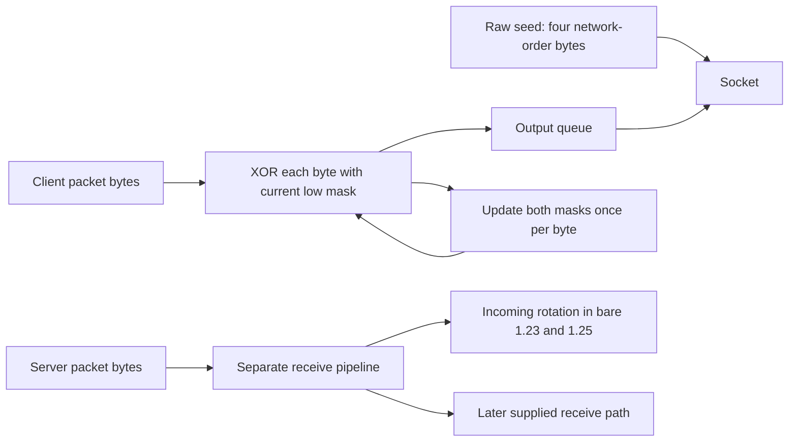

# Early Classic rotation cipher

Evidence from the eight supplied `client_1.*` executables in
`/mnt/dati/_proj_local/_uo_clients/_exe`, examined on 2026-11-15.
These clients share one client-to-server cipher implementation across their login
and game connections. Disabling its byte XOR removes both uses together. They do
not have KR's 0xE3/0xE4 exchange.

**Scope correction from the subsequent protocol audit:** the completed patch
removes the shared **outgoing** cipher. The supplied bare `1.23` and `1.25`
clients also have a separate incoming rotation cipher, which this patch does
not remove and Sphere's present `ENC_LOGIN` output does not reproduce. Their
full connections therefore cannot yet be described as bidirectionally plaintext
or fully compatible with Sphere. The later supplied `1.25.34`–`1.25.36` clients
have a different receive path. Details and evidence are below.

The implemented patcher phase is commit `6a741e57` (`Support early Classic
encryption patching`); its separate Source-X counterpart is `94534efe`, detailed
below. This report explains the cipher already implemented and tested. The
[early Classic login sequence reference](early-classic-login.md) explains the
client packet handlers and selection screens. The
[Sphere compatibility plan](../SPHERE_CLASSIC_COMPATIBILITY.md) distinguishes
that completed cipher work from the older protocol work still required before
claiming a complete login and playable session.

## Seed, master keys and stream state are different values

| Value | Where it comes from | Lifetime and purpose |
| --- | --- | --- |
| Connection seed | A four-byte value sent openly before ciphered traffic | Initializes a new connection's state; a game reconnect takes its seed from the relay auth ID. |
| Master high / master low | Immediate constants in the executable's cipher instructions | Identify the byte transform used by that build; remain fixed while the connection is running. |
| Current outgoing high / low masks | Calculated initially from the seed, then updated after every outgoing byte | Form the changing C2S stream state; must stay synchronized between client output and server input. |
| Separate incoming high / low masks in bare `1.23`/`1.25` | Initialized by connection setup, then stepped by their receive loop | Form an independent S2C stream; they are not the outgoing masks and remain active after the completed send-only patch. |
| Current byte position | Implicit in how many bytes have already passed through the state updates | Continues across packets and socket read boundaries on the same connection. |

The early clients do not send the master keys in the seed. Knowing the seed
alone does not select the right transform; knowing the keys alone does not tell
the server the current stream position. The server needs the algorithm, its
actual constants, the connection seed, and the correct state lifecycle.

The commonly used version formula predicts many later master-key pairs. It is
not the connection-seed formula, and these clients need not calculate their
embedded constants from a version at runtime. The supplied bare `1.23` and
`1.25` executables demonstrate why direct extraction matters: their common
fixed pair differs from the later formula's result for those version labels.
The `g`, `h` and `i` suffixes on the supplied `1.25.35` builds do not change
that group's embedded cipher keys.

The name "rotation cipher" refers to its state update: bits shift right
through two 32-bit words, with bits from one word carried into the other.
The byte itself is XORed with the low eight bits of the current low mask; its
bits are not individually rotated. This is also why "remove the encryption"
means bypassing the byte XOR while preserving the surrounding packet writer.

## Where the cipher sits in the connection

The cipher implemented by the completed patcher phase is client-to-server. The login request (`0x80`), game
login (`0x91`) and following outbound packets reach the same cipher-append
function. It does not stop after credentials or run only once per login.
The raw seed goes directly to the socket before these packets, outside the byte
XOR loop. Its four bytes therefore do not advance the cipher state.



The server reverses client output with the same XOR and state updates. Server
responses do not use this outgoing rotation stream, and must not advance the
server's C2S receive state. In Sphere, `ENC_LOGIN` selects `DecryptLogin` for
incoming client bytes even after the connection changes to the game phase;
`CCrypto::Encrypt` currently copies server output without rotation encryption.
That existing server behavior is tested, but it does not match the separate
incoming cipher found in the bare `1.23` and `1.25` executables.

Huffman compression and packet framing are separate concerns. Removing an
outgoing byte XOR changes neither. The precise receive/compression route must
be checked per native protocol group; the outgoing cipher tests do not establish
that all eight supplied clients expect the same server-output pipeline.

There is no Diffie-Hellman/AES setup or `0xE3`/`0xE4` handshake in these early
Classic paths. KR's handshake bypass addresses a different connection design.

## Patcher usage

```sh
uocf-cli exe show client_1.25.36.exe --crypt-keys
uocf-cli exe patch client_1.25.36.exe --no-encryption --output client_1.25.36-plaintext.exe
```

The GUI exposes the same shared control in the Login server section. A differently named output can be beside
the source; the source executable is never overwritten. Individual login/game cipher flags are refused for
these shared routines. Configure the destination with the Classic `login.cfg` tools. Facet editing and data
validation remain unavailable because these executables predate the supported facet tables.

`exe show --crypt-keys` is useful with encryption retained: it reports the
principal constants from the real code, the recognized algorithm and the XOR's
stock/patched state. It does not generate a connection seed or edit Sphere's
crypt table. The keys remain readable after a NOP patch because the state-update
instructions are retained.

### Why early Classic has one control

The supplied Classic clients have one outgoing cipher function used by both
connection phases. A two-byte edit there necessarily affects outgoing login and
game traffic. "Shared" describes the phases, not both network directions; the
bare clients' separate incoming cipher is still outside this control.
The shared control describes that actual effect. Separate phase controls would
require additional phase-dependent dispatch or connection-setup changes; this
implementation does not pretend that the same XOR belongs to two independent
sites.

The inspected EC/KR clients have separate login and game transform objects or
adapters, so their patcher controls can select those groups independently. KR
also has the independent handshake control. See the
[encryption controls reference](../ENCRYPTION.md) for those builds; the presence
of a rotation-based login transform in two client families does not imply an
identical game connection or seed protocol.

## Executable identities and patch sites

These addresses and hashes identify regression evidence; runtime selection does
not consult them. Each examined image has preferred base `0x00400000` and its
`.text` file offset differs from its VA by `0x00400c00`. The `1.23` executable is
unoptimized, `1.25.36` has the multikey loop, and the others share the optimized
single rotation layout.

| Input filename | SHA-256 | Cipher function VA | Function file offset | XOR VA | XOR file offset |
| --- | --- | --- | --- | --- | --- |
| `client_1.23.exe` | `e5ebe07148034b8d7f47e2828075ce93ef779c53fb3acf8edc7cdca5aac35195` | `0x004984b2` | `0x978b2` | `0x0049850a` | `0x9790a` |
| `client_1.25.0.exe` | `35c4903d50c56c5f8f1de5e5fb72ec310d0e5b074656be31a20ebf82946d6f02` | `0x00469fb0` | `0x693b0` | `0x00469ff4` | `0x693f4` |
| `client_1.25.34.exe` | `b36482dc091c0c0d333636271766a5ce8ef4be4002a2c7d44ff96b47fe2f09c4` | `0x00488340` | `0x87740` | `0x00488384` | `0x87784` |
| `client_1.25.35.exe` | `dc2c53d70ff1595d2a6f16a50794a4cd42c9a1823879a9fc7e46d15bb7297f57` | `0x00489610` | `0x88a10` | `0x00489654` | `0x88a54` |
| `client_1.25.35g.exe` | `8363693e3d8634985aa7ed2599566551423990fce8bc337af3bb1fe3ab2f059d` | `0x004895a0` | `0x889a0` | `0x004895e4` | `0x889e4` |
| `client_1.25.35h.exe` | `9dfe78e72ca03acb71c753729bbf8d3a4f9b7c71d74b8fabdc54c8d58ec40aa3` | `0x004895c0` | `0x889c0` | `0x00489604` | `0x88a04` |
| `client_1.25.35i.exe` | `07944a089187e5fbcc8c14196898487135683fab0d1c101f4549d31273a6d601` | `0x00489600` | `0x88a00` | `0x00489644` | `0x88a44` |
| `client_1.25.36.exe` | `60d62325b911b08bcf672f207cfba3f0bc35136a40e4318881b66630bb238ccb` | `0x00489300` | `0x88700` | `0x00489348` | `0x88748` |

There is no `VS_FIXEDFILEINFO` version resource in these files. Their embedded
ASCII labels are `1.23`, `1.25`, `1.25.34`, `1.25.35`, `1.25.35g`, `1.25.35h`,
`1.25.35i` and `1.25.36`, respectively. A filename's `.0` must not be presented
as a version extracted from the executable.

## Algorithms and actual keys

The executable's instructions define the keys. In particular, the first two
files do not contain the values generated by applying the later version formula
to `1.23.0` or `1.25.0`.

| Examined files | Algorithm | Master high | Master low |
| --- | --- | --- | --- |
| `client_1.23`, `client_1.25.0` | Single rotation | `f1a372d5` | `3a1fd527` |
| `client_1.25.34` | Single rotation | `38ecedac` | `025720c6` |
| `client_1.25.35`, `g`, `h`, `i` | Single rotation | `383477bc` | `02345cc6` |
| `client_1.25.36` | Multikey | `387fc5cc` | `021510c6` |

### One byte, in order

For every byte, including zero bytes in padded fields:

1. Read the old `lo` and `hi` state words.
2. Calculate `output = input ^ (lo & 0xff)` using the old low byte.
3. Calculate both next state words with the algorithm below.
4. Store the next state and continue with the next input byte.

For example, seed `12345678` produces initial masks `lo=bad0fcd2` and
`hi=46065115`. Before any updates, plaintext `80` becomes `52` because
`80 ^ d2 = 52`; a first plaintext byte `91` instead becomes `43`.
These examples describe fresh streams. The same packet bytes later in a stream
need not produce the same ciphertext.

The XOR is symmetric: `(input ^ mask) ^ mask = input`. The state update depends
on the previous state and constants, not on whether the byte is plaintext or
ciphertext. The server therefore executes the same state update while decoding.
A packet split across two reads gives the same result as one contiguous read
provided the state is carried forward. Resetting at every packet or every read
would decode the first segment and then lose synchronization.

All arithmetic below uses unsigned 32-bit words: additions, subtractions,
multiplications and left shifts discard bits above bit 31, and right shifts are
logical. In the single rotation equations, both right-hand sides use the old
state. In the multikey equations, `next_lo` deliberately uses the newly computed
`next_hi`. Applying these steps in a different order changes the stream.

### Single rotation, verified in seven supplied files

Single rotation:

```text
next_lo = ((lo >> 1) | (hi << 31)) ^ master_low
next_hi = ((hi >> 1) | (lo << 31)) ^ master_high
```

### Multikey, verified in the supplied 1.25.36 file

The special implementation contains six principal arithmetic constants: the two
master values shown above, and the four additional coefficients below. The
server table stores the first pair because the other four belong to its
version-specific algorithm branch. The patcher's public `LoginMasterKeys` also
reports that pair; the dynamic signature validates the retained special
coefficient instructions rather than treating an unrelated rotation loop as
multikey.

The 1.25.36 multikey step:

```text
next_hi = (master_high >> ((5 * hi * hi) & 31))
          + hi * master_high + lo * lo * 0x35ce9581 + 0x07afcc37
next_lo = (master_low >> ((3 * lo * lo) & 31))
          + lo * master_low - next_hi * next_hi * 0x4c3a1353 + 0x16ef783f
```

At `0x48939f` and `0x4893cc`, actual x86 `SHR r32,CL` instructions mask the
count to its low five bits. Treating counts of 32 or more as a zero result does
not reproduce the client. This was confirmed by executing the function, not
only inferred from the disassembly.

The multikey client also checks a separate global copy of `hi` at each byte and
updates it after the step. That integrity check stays active under the XOR-only
patch; the patch leaves mask evolution untouched.

### Later rotation variants: source coverage differs from binary coverage

Sphere's current `CCryptoLogin.cpp` chooses the following algorithm for client
version IDs `>= 1253700` (`1.25.37`):

```text
next_lo = ((lo >> 1) | (hi << 31)) ^ master_low
intermediate_hi = ((hi >> 1) | (lo << 31)) ^ master_high
next_hi = ((intermediate_hi >> 1) | (lo << 31)) ^ master_high
```

The second high-word update uses the old `lo` again. This explains why sharing
the seed-initialization formula and a master-key table is insufficient to select
the right algorithm. It is distinct from both the older single rotation and the
1.25.36 multiplication/variable-shift branch.

This boundary is supported by the local server source and table, not by a
`1.25.37` executable examined in this phase. `sphereCrypt.ini` assigns
`ENC_LOGIN` through `1.25.37`, then `ENC_BFISH` at `1.26.0`: its intended policy
is rotation for client-to-server game traffic before that transition and a
separate game algorithm afterward. This is a server compatibility policy, not
new binary coverage. None of those later Classic versions is added to the
patcher's accepted layouts by this report. EC/KR's already supported modern
login transforms are described separately in [ENCRYPTION.md](../ENCRYPTION.md).

## Separate incoming cipher in bare 1.23 and 1.25

Later protocol tracing found active server-to-client decryption in the two bare
clients, independent of the outgoing masks and master keys above:

| Client | Receive evidence | State fields and step constants |
| --- | --- | --- |
| Bare `1.23` | Socket `recv` at `0x498ac9`; cipher-enable check at `0x498afd`; byte XOR at `0x498b3a` | Object fields `0x20018`/`0x2001c`; constants `af572d13`/`fa7d5231` at `0x498bcb`/`0x498ba5`. |
| Bare `1.25` (`client_1.25.0.exe`) | Receive-loop mask load at `0x46a4e0`; the following output XOR uses this mask byte | Same fields; constants `af572d13`/`fa7d5231` at `0x46a52d`/`0x46a516`. |

Connection setup initializes those fields. Its nibble-mask expressions simplify
to the following, with the same native numeric seed:

```text
receive_lo = seed ^ 0xa8612ae5
receive_hi = seed ^ 0x044cc16d
```

Each incoming byte is XORed with the low byte of the old `receive_lo`, and the
state steps left rather than right:

```text
next_receive_lo = ((receive_lo << 1) | (receive_hi >> 31)) ^ 0xaf572d13
next_receive_hi = ((receive_hi << 1) | (receive_lo >> 31)) ^ 0xfa7d5231
```

Both right-hand sides use the old receive state. These equations are supported
by the native initialization and receive disassembly; they have not been added
to Sphere or covered by the completed outgoing-cipher execution tests. The same
`0x20020` enable flag tested by the outgoing code gates this receive loop, and
connection setup enables it. NOPing only the outgoing XOR leaves that flag and
the incoming XOR active.

For the bare `1.23` binary, the original initialization is visible as split
nibble expressions at the stores `0x498772` and `0x49879e`:

```text
receive_lo = ((seed & 0xf0f0f0f0) ^ 0xa06020e0)
             | (((~seed) & 0x0f0f0f0f) ^ 0x070e050a)
receive_hi = (((~seed) & 0xf0f0f0f0) ^ 0xf0b03090)
             | ((seed & 0x0f0f0f0f) ^ 0x040c010d)
```

Each XOR constant occupies its selected nibbles, so the OR combines disjoint
fields; simplifying gives the two seed-XOR equations above. This is arithmetic
interpretation of the initialization, not an executed validation of the receive
routine.

The bare `1.23` route goes from receive function `0x4988eb`, through its optional
incoming rotation, to direct packet framing at `0x498d9b` and dispatch at
`0x49922e`. Bare `1.25` similarly follows `0x46a3a0` through optional incoming
rotation to framing at `0x46a6b0` and dispatch at `0x46a920`. No Huffman decoder
or decoding bit walk occurs on these audited routes; that statement does not
assert that no compression-related code exists elsewhere in either executable.

The supplied `1.25.34`, `1.25.35` (including `g`/`h`/`i`) and `1.25.36`
setup functions retain stores to the old receive-state offsets, but their traced
receive paths use the compression/Huffman branch rather than the bare clients'
left-rotation loop. Retained initialization is not proof that an active
cipher exists. This change in native receive behavior is another reason to
separate the bare clients from the later `1.25.x` group in the protocol plan.
The exact per-group receive and compression evidence is maintained in
[early-classic-login.md](early-classic-login.md).

Sphere's existing `Encrypt` comment suggests that early clients do not decrypt
server output. That comment is not authoritative for these two supplied bare
binaries: their active receive code provides contrary evidence. Implementing
that direction or removing it requires a separate validated change; neither was
part of commit `6a741e57` or `94534efe`.

## Seed and outgoing-state lifecycle

The initial masks derive from the connection seed, with wrapping 32-bit values:

```text
lo = (((~seed) ^ 0x00001357) << 16) | ((seed ^ 0xffffaaaa) & 0x0000ffff)
hi = ((seed ^ 0x43210000) >> 16) | (((~seed) ^ 0xabcdffff) & 0xffff0000)
```

The executable sends the seed as four big-endian raw bytes and then queues
ciphered packets. There is no 0xEF version-bearing seed writer in these paths.
The seed defaults to the local host address if no existing seed was supplied;
it is not derived from the client version.

The client builds the masks from the native numeric seed, then calls `htonl`
before writing the four seed bytes. For the example numeric seed `12345678`, the
wire prefix is `12 34 56 78`, not the little-endian in-memory representation
`78 56 34 12`. The relay's auth ID is converted from network order before it
becomes the native seed. The 65-byte `0x91` writers in the supplied `1.25` and
later builds write that auth ID in network order again. Bare `1.23` instead
writes `91 00`, with no auth-ID or credential field in that packet.
Confusing these representations produces different masks even with the right
master keys.

| Event | Rotation-state behavior |
| --- | --- |
| Initial connection is opened | Initialize `lo` and `hi` from its seed. |
| Raw seed is sent | Leave state unchanged; this write bypasses the cipher queue. |
| `0x80` and later login bytes are queued | XOR and step once per byte, keeping state across packets. |
| Relay opens a new game socket | Initialize a fresh state from the relay auth ID, send that raw seed, then cipher `0x91`. |
| Relay retains the existing socket | Continue the old stream; the presence of an auth ID or `0x91` alone does not reset masks. |
| Server sends a reply | Leave the client-output/server-input state unchanged; the bare clients advance their separate incoming masks while receiving those bytes. |
| XOR is patched to NOPs | Queue plaintext bytes while the same state updates still execute. |

A connection's role changing from login to game is therefore not sufficient
reason to reset the rotation state. Follow the actual socket/setup route. In
Sphere's existing `ENC_LOGIN` path, incoming game bytes still use
`DecryptLogin`; its `InitFast` relay setup updates connection metadata without
reinitializing the two rotation masks. The public-API regression tests exercise
this distinction as well as fresh game connection initialization.

Confirmed `1.23` call graph:

- `0x499b49` serializes each packet and calls cipher append `0x4984b2` at
  `0x499bd4`.
- Connect `0x4985da` initializes `lo`/`hi` at object offsets `0x20010`/`0x20014`
  from global seed `0x006b1fcc`, sets cipher enable `0x20020`, and sends the
  seed through the socket import at `0x4987ca`.
- Relay handler `0x482381` parses the relay address, port and auth ID. Its
  `0x4823c4` argument points directly to the seed global; the parser converts
  the auth ID from the packet's network order. A new connection calls the same
  connect method at `0x48245a`; game packet construction at `0x48254c` then
  reaches the same packet writer at `0x482562`.

Confirmed `1.25.36` call graph:

- Packet writer `0x48aed0` calls cipher append `0x489300` at `0x48af17`.
- Connect `0x489430` initializes `lo`/`hi` from seed global `0x007120a8`, sends
  the raw seed at `0x4895bd`, and initializes the integrity copy at `0x00777238`.
- Relay handler `0x4725c0` reads the auth ID at `0x47264d`, converts network
  order and stores it as the next seed at `0x47265e`. It calls connect at
  `0x47274b`, constructs 0x91 with that auth ID at `0x472836` onward, then calls
  the packet writer at `0x472954`.

The optimized single rotation clients retain the same object offsets, seed
initialization and packet-writer/cipher relationship. In `1.25.0`, the respective
cipher and connect functions are `0x469fb0` and `0x46a080`.

Do not reinitialize the stream between packets on an existing connection.
There are relay branches which retain the existing socket rather than reconnect;
those branches retain its current mask state. A newly opened game connection
uses freshly initialized masks for the relay auth ID. The functions also contain
a pre-existing global branch which bypasses the encryption setup; it cannot be
used as a transparent encryption-only control. In bare `1.23`, the check of
`0x006b1fa0` at `0x4986be` branches directly to `0x4987d1`, skipping both mask
initialization **and the raw four-byte seed send**, then sets `0x20020` to zero.
Using that route would change the wire framing as well as both cipher directions.
The verified XOR-only patch deliberately preserves seed transmission and queue
behavior; the separate active incoming cipher is its explicitly documented
remaining limitation.

## Dynamic patch acceptance

`lib/uocf/src/client/classic_login.rs` recognizes three complete cipher function
shapes: unoptimized single rotation (296 bytes), optimized single rotation (204
bytes), and multikey (296 bytes). Keys and address operands are decoded, while
opcodes, operand registers, state fields, bounds checks, loop edges, queue copy
path and returns must match. The resolver also requires a complete seed
initialization block with writable seed storage and a matching packet-writer
call to the candidate function. The multikey layout additionally validates both
copies of each master key, its writable integrity global, and the failure call's
code target. Unknown or ambiguous layouts are refused.

The shared control replaces only the two-byte outgoing XOR with `90 90`:

| Shape | Function-relative patch | Original | Replacement |
| --- | --- | --- | --- |
| Unoptimized | `0x58` | `33 c2` (`XOR EAX,EDX`) | `90 90` |
| Optimized | `0x44` | `32 d1` (`XOR DL,CL`) | `90 90` |
| Multikey | `0x48` | `32 ca` (`XOR CL,DL`) | `90 90` |

The byte store, queue length, mask updates and socket setup still execute.
Server-to-client handling is independent: the bare clients' incoming rotation
cipher remains active, and any compression expected by a native protocol group
is left unchanged.

## Implementation map

The completed implementation keeps byte discovery, executable capabilities,
patch planning and user-facing output separate:

| Source | Responsibility and contract |
| --- | --- |
| [`classic_login.rs`](../../../../lib/uocf/src/client/classic_login.rs) | Internal `locate(bytes, pe)` returns validated candidates with XOR offset, original instruction bytes, removal state, extracted keys and algorithm. It searches the three instruction layouts and validates the seed/writer edges. |
| [`encryption.rs`](../../../../lib/uocf/src/client/encryption.rs) | `CipherSiteKind::SharedLoginGameCipher` belongs to `EncryptionPart::SharedLoginGame`. A uniquely supported Classic graph exposes one shared outgoing site; unknown Classic layouts gain no claimed encryption capability. |
| [`crypt_keys.rs`](../../../../lib/uocf/src/client/crypt_keys.rs) | Public `inspect_login_crypt` returns `LoginCryptInfo`, `LoginMasterKeys` and `LoginCipherAlgorithm`. Early variants report `ClassicRotation` or `ClassicMultiKey12536`; `protocol_version` is `None`, with zero 0xEF writer matches. |
| [`facet_dimensions.rs`](../../../../lib/uocf/src/client/facet_dimensions.rs) | `ClientExeInspection` accepts the recognized early cipher graph without fabricating a supported facet table. Cipher support does not imply facet patch/data-validation support. |
| [`patch.rs`](../../../../lib/uocf/src/client/patch.rs) | `ExeEdit::NoEncryption` plans the shared edit and existing PE checksum/manifest handling. Independent phase edits are refused on these Classic shared sites. |
| [`tools/uocf-cli/src/exe.rs`](../../../../tools/uocf-cli/src/exe.rs) and the GUI's Login server logic | Expose the actual shared behavior and key extraction, while preserving the source-copy output policy. |

For early clients, the public `keys.key_1` field means master high, `keys.key_2`
means master low, and `keys.first_round` repeats master high for compatibility
with the existing result type. It is not a third independent early-client key.
For modern login layouts, the extra first-round immediate is separately
extracted and can matter to reproducing their transform.

`EncryptionState::Removed` describes the set of sites known to this patcher.
For these clients, that set currently contains the outgoing shared XOR only.
It must not be read as proof that the bare clients' separate incoming cipher
was removed. The flag's name predates this later receive-path finding.

There is no new runtime version/hash profile for the early clients. The complete
opcode templates contain variable operands where keys or addresses may move;
the resolver checks their relationships and the PE section bounds. A version
not included in the eight fixtures may work only if it has one of these verified
layouts and passes all checks. A different algorithm, modified instruction or
ambiguous graph must be researched before it can be patched.

## Executed validation

The complete cipher functions were extracted read-only and executed inside small
Linux ELF32 harnesses under `qemu-i386`. The harness populated the connection
object fields and, for 1.25.36, mapped its integrity global. It called the original
function ABI (`ECX = object`, stack arguments `buffer, length`, callee pops 8).
No Windows client or network connection was needed for this check.

For each of eight original functions and each XOR-only replacement:

- Seeds `00000000`, `00000001`, `12345678`, `ffffffff`, `7f000001`.
- Input bytes `i mod 256` for `i = 0..1023`.
- One 1024-byte call and successive chunk lengths `1, 61, 3, 16, 259, 684`.
- Check every output byte, final `lo`, final `hi`, and queued byte count.

All 80 original cases match independent algorithm calculations. All 80 patched
cases produce identity bytes and the same final masks and queue count as their
originals. This covers preservation of stream state across packet-size splits.

The eight complete executables were also patched through the built `uocf-cli`, reopened with `--crypt-keys`,
and checked for unchanged source bytes. Only each two-byte XOR and the PE checksum changed. Extracting the
functions from those actual output files, without any further modifications in the harness, passed the same
80 plaintext cases. Library tests cover moved code, different keys, unknown/ambiguous code, malformed helpers,
key extraction after patching and absent facet capabilities; the CLI/GUI tests cover patch/write/reopen.

```sh
cargo test -p uocf --lib client::
cargo test -p uocf-cli -p uo-client-patcher-gui
cargo test -p uocf --test real_files early_classic_shared_encryption_round_trips_all_audited_executables -- --ignored
```

For the last command, set `UO_EARLY_CLASSIC_EXES` to the eight full executable paths, separated by the host
platform's path-list separator (`:` on Linux). The hashes in that test are fixture assertions, not runtime
selectors. All 80 client-library tests, the CLI/GUI suite and the eight-file regression passed.
The existing nineteen-build KR executable regression and `cargo check --workspace` also passed after this
inspection API change.

Golden output below uses seed `12345678`, initial `lo=bad0fcd2`,
`hi=46065115`, the first 64 ciphered bytes of that input, and final masks after
1024 bytes. Repeated `1.25.35` letter builds have identical vectors.

| Client | First 64 ciphered bytes (hex) | Final low | Final high |
| --- | --- | --- | --- |
| `client_1.23` | `d24f826490e85708a8fe56826f1b22beef4999f142997700b4e8c5531fbbeac269228457398cd5f9e0eaec6fa9c8fb623196c6ee7d3690c3e570391d8840a7d4` | `0xbad0fcd2` | `0x46065115` |
| `client_1.25.34` | `d2ae930d456373fbb013c128db205ee121cf3b41fba4881edabe0fd7bc8b13df86b4aea32260c293b421e88cb9216ec905ed1a61db04e89e2a76db8d21f51ce8` | `0xbad0fcd2` | `0x46065115` |
| `client_1.25.35` | `d2ae930dc523d3ab18c7ab9d01cda89a9c11d4b6005976e12541f02843746ce099bba920e300724b5857d391b7a62de895a53e73d200ea9f2a76db8d21f51ce8` | `0xbad0fcd2` | `0x46065115` |
| `client_1.25.36` | `d23d7312fe655f9308d01e0bd5190ed60411cb0714cc0217c10d1ac2081dc70b20f83623fd3126fe3c29f33f2cf43a2fe92532ea2035ef2338e02e3be5293ee6` | `0xbe283014` | `0xbecf4f77` |

These checks prove the byte transform and patch ABI. They do not prove a full
interactive login, character creation, or every older packet-format detail.
Research harnesses and disassembly are kept in `/tmp/early-uo-crypto`, outside
source; no complete executable files or patched binaries are checked in.

## Server compatibility beyond encryption

Cipher success does not imply all modern server packets are accepted:

- `1.23` receive dispatch subtracts `0x11` and rejects values above `0x89`
  (`0x49937e`–`0x49938b`): implemented packet IDs end at `0x9a`.
- `1.25.0` dispatch subtracts `0x11` and rejects above `0x92`
  (`0x46aa3e`–`0x46aa46`): implemented IDs end at `0xa3`.
- `1.25.36` dispatch subtracts `0x11` and rejects above `0xa8`
  (`0x48a1f7`–`0x48a1ff`): implemented IDs end at `0xb9`.

The first two cannot handle 0xB9 enable-features or 0xBD client-version request.
The last cannot handle 0xBD. Their packet-length tables also predate those later
IDs, so sending an unsupported packet can desynchronize parsing before the
handler switch is reached. Sphere must avoid requesting a client-version packet
from these old builds during login; its existing game-stage version checks alone
do not protect the earlier login-stage send.

## Why Sphere needed changes

The original server implementation already had the old single rotation branch,
the 1.25.36 branch, and `ENC_LOGIN` handling for both connection phases. The
completed work corrected the mismatches below without adding a new outgoing
encryption family:

| Mismatch | Observable consequence | Completed correction |
| --- | --- | --- |
| The fixed `f1a372d5 / 3a1fd527` pair was absent from the crypt table | Correctly encrypted bare `1.23`/`1.25` credentials could not be recognized using the supplied table. | Add the observed pair as an old `ENC_LOGIN` entry without replacing the existing formula-based `1250000` entry. |
| 1.25.36 shifts of 32 or more were forced to zero | Server mask evolution diverged from the real x86 routine after the initial bytes, even with the right seed and master keys. | Mask the count with `0x1f`, matching `SHR r32,CL`. |
| Plaintext copy rejected `inLen == outLen` | A correctly sized separate output buffer could be refused for an unencrypted login. | Reject only lengths greater than the output capacity. |
| The login stage sent `0xBD` before its existing game-stage version gate applied | A correctly decrypted old client could still receive an unsupported protocol packet. | Gate the earlier version request for recognized old clients. |

The entry number `1230000` is Sphere's algorithm/version selector for the fixed
pair. It does not prove that both identical streams came from a literal
`1.23.0` binary, nor identify which of the bare `1.23` and `1.25` clients is
connected. The crypt table and the packet-version policy solve related but
separate problems. Plaintext has no master-key identity to recover, and these
old clients cannot answer a later `0xBD` query to fill that gap.

## Sphere implementation and remaining protocol work

The accompanying Source-X changes correct the existing crypto implementation;
validation of the separate server build is tracked with that patch:

- `CCryptoLogin.cpp` masks both multikey shift counts to five bits, matching the
  executed x86 instructions. It also permits copying exactly the output capacity
  in the plaintext path.
- `sphereCrypt.ini` adds the observed fixed pair under `1230000` with
  `ENC_LOGIN`. The existing `1250000` formula-derived entry is retained because
  another build may need it. Both supplied bare `1.23` and `1.25` executables
  have the same fixed keys, so crypto detection alone conservatively identifies
  that stream as `1.23`; it cannot distinguish the two releases.
- Sphere avoids its early 0xBD version request for a recognized old encrypted
  client. The request is newer than their supported receive vocabulary. Its game-stage
  gate did not previously prevent that earlier login-stage send.

There are additional protocol gaps for the bare `1.23` and `1.25` executables:
their dispatch ranges end before 0xA8 server lists, 0xA9 character lists and 0xB9
feature flags. Supporting these earliest clients through a complete interactive
session therefore also requires their older packet layouts, independently of the
cipher fixes. A plaintext patched old executable has no cryptographic version
identity, and cannot answer a 0xBD request. The 62-byte login packet alone does not identify its exact old protocol
release. The later supplied clients use a 65-byte game-login request, while the
bare `1.23` native constructor emits a two-byte `91 00` instead. These are
separate protocol paths, not interchangeable cipher probes. Do not infer an
exact release or claim a full interactive login from the cipher tests.

## Sphere regression and build evidence

The protocol changes required for native old selection screens are documented
in [early-classic-login.md](early-classic-login.md), with staged server work in
[SPHERE_CLASSIC_COMPATIBILITY.md](../SPHERE_CLASSIC_COMPATIBILITY.md). They are
not implemented by the cipher commit.

The complete reviewable Source-X diff is
[sphere-classic-rotation.patch](sphere-classic-rotation.patch). It includes the
public-API tests and their CMake registration, and does not modify the running
server's configuration or executable.
The local Source-X phase is committed as `94534efe` (`Fix early Classic rotation encryption compatibility`).

`tests/src/t_CCrypto.cpp` uses ciphertexts obtained by executing the four
distinct original client **send cipher routines** on constructed test buffers:
a conventional 62-byte `0x80` request, a conventional 65-byte `0x91` request,
seed `12345678`, a shard-selection-shaped buffer and a following ping. The
shared-key letter builds do not require duplicate vectors. These are transform
probes, not packet-writer captures. In particular, the constructed 65-byte probe
is not the native bare `1.23` game request: its `0x482a83` constructor emits
`91 00`, and its packet-length table declares a two-byte `0x91`. This limitation
does not change the cipher test results, but prevents treating them as proof of
native game-login compatibility. The tests cover:

- Automatic rotation-key detection for the constructed fresh login/game probes.
- Exact output-buffer sizes, split input, in-place decryption and later packets.
- Retaining the rotation stream on a socket across `InitFast` relay setup.
- Plaintext fresh login/game connections and subsequent in-place packets.
- Sphere's current plaintext server output for `ENC_LOGIN`, without advancing its C2S receive stream; this does not validate the bare clients' separate S2C cipher.

A clean isolated Clang 22 Debug build with `UNIT_TESTING=ON` completed. Its focused
runner passed all **4 new cases / 192 assertions**, exit status 0. Linking the same
runner against the original `CCryptoLogin.cpp` instead produced **3 failed
cases**: both 1.25.36 connection detections and the exact-size plaintext login
copy. This confirms that the fixtures detect the corrected behavior.

The full existing CTest suite ran 9 cases: 8 passed and the existing
`CUOClientVersion parsing` case failed 15 string-parsing assertions. That parser
was not changed. There are two independent harness limitations in this checkout:

- The cached doctest 2.4.12 header needs `-Wno-c2y-extensions` **after**
  `-Wpedantic` with Clang 22. This flag was supplied only through a temporary
  CMake include; repository compiler options were not changed.
- Sphere's test entry point ignores command-line filters. A temporary runner
  enabled the filter for `t_CCrypto.cpp`, then called `_Exit(result)` after
  doctest returned and all case fixtures had destructed. This avoids an
  unrelated shutdown bug: `reserved_stdout_log` in `common.cpp` passes a
  `va_list` to `fprintf` instead of `vfprintf`. GDB traced the post-success
  crash through `AbstractThread::~AbstractThread` and `strlen`. No production
  workaround or unrelated logger edit is included in the patch.

Artifacts are under `/tmp/sphere-early-crypto`. The clean build commands were:

```sh
cmake -S /mnt/dati/_proj_local/_Source-X -B /tmp/sphere-early-crypto/build -G Ninja -DCMAKE_BUILD_TYPE=Debug -DUNIT_TESTING=ON -DFETCHCONTENT_SOURCE_DIR_DOCTEST=/mnt/dati/_proj_local/_Source-X/external/doctest -DFETCHCONTENT_UPDATES_DISCONNECTED=ON -DCMAKE_TOOLCHAIN_FILE=/mnt/dati/_proj_local/_Source-X/cmake/toolchains/Linux-Clang-x86_64.cmake -DCMAKE_PROJECT_SphereServer_INCLUDE=/tmp/sphere-early-crypto/clang22-tests.cmake
cmake --build /tmp/sphere-early-crypto/build --target spheresvr_debug -j 6
ctest --test-dir /tmp/sphere-early-crypto/build --output-on-failure
python3 /tmp/sphere-early-crypto/verify_regressions.py
python3 /tmp/sphere-early-crypto/build_normal.py
```

The temporary compatibility include defers appending the doctest warning flag
until Sphere's target options have been set. The final command compiles the
current normal entry point without `UNIT_TESTING` and relinks the same consistent
Debug objects with all test objects removed. The resulting review build is
`/tmp/sphere-early-crypto/SphereSvrX64_early_rotation_debug`; it was inspected as an
ELF x86-64 executable and **not started or deployed**. No interactive Windows
client login or live-server packet sequence was tested by these checks.

## Reading the evidence without extending its claim

The three kinds of evidence answer different questions:

- **Disassembly and graph validation** identify where each supplied client seeds,
  queues and transforms bytes, and which instruction layouts the patcher accepts.
- **Executed original and patched routines** establish the exact cipher output,
  ABI, state progression and identity-byte patch behavior for the tested inputs.
  They include actual production CLI output files, not only synthetic routines.
- **Sphere public-API regressions** establish key detection and decryption of
  the constructed login/game probes, chunking, in-place buffers and continuation.
  They do not establish that the native bare `1.23` two-byte game packet is
  recognized, or implement the bare clients' incoming cipher. The isolated build
  establishes that the separate source patch compiles.

None of these alone drives an original Windows UI through a live Sphere world.
Correct ciphering does not make an unsupported server-list, character-list,
world-entry or gameplay packet acceptable. The server protocol plan must retain
that boundary when reporting progress. The review binary was not deployed, the
running server was not changed, and original executable fixtures were not
modified by this work.
