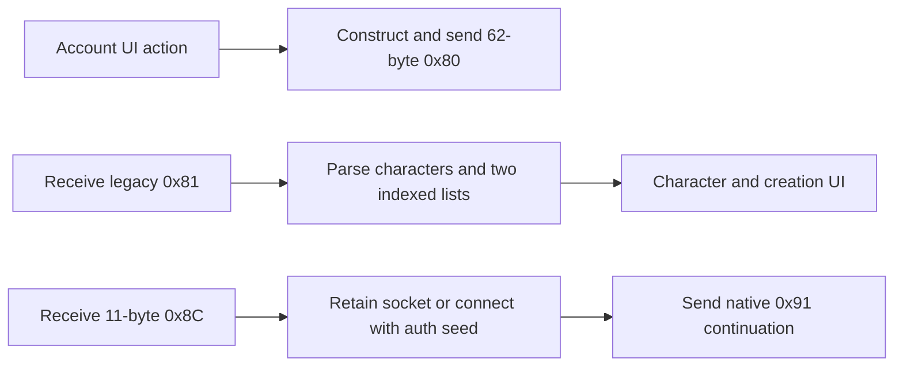
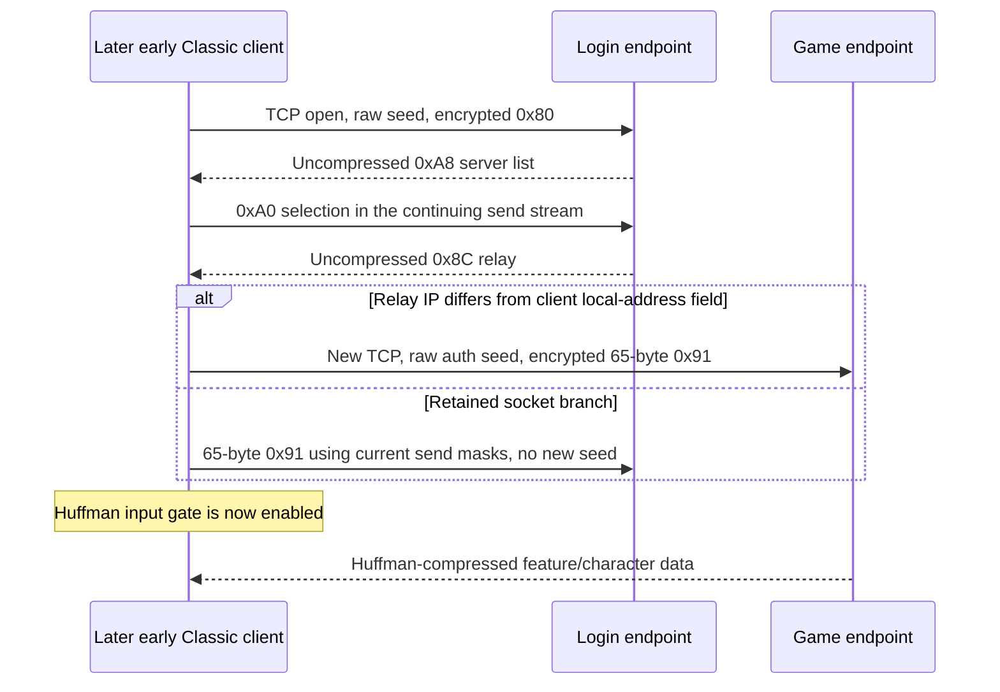

# Early Classic login sequences and packet layouts

This is a reconstruction from the eight supplied `client_1.*` executables in
`/mnt/dati/_proj_local/_uo_clients/_exe`, inspected on 2026-11-15. Their identities,
embedded labels, outgoing keys and patch sites are in
[the rotation cipher report](classic-rotation-cipher.md). None has a fixed PE version resource; the
file named `client_1.25.0.exe` identifies itself with the embedded string `1.25`.

The directory contains these eight early Classic files and the separately documented KR collection. It
does not supply a continuous history of early Classic releases. In particular, the behavior between the bare
`1.25` file and `1.25.34` must not be inferred by interpolating version numbers. Later Classic cipher eras
described from server source are [separate context](../ENCRYPTION.md#later-classic-eras-sphere-source-context).

## What the evidence proves

**Observed native code** means an instruction path, packet table entry or caller/callee relationship was
checked in the named executable. Addresses below are preferred-image virtual addresses, not runtime selectors.
**Inferred sequence** means a possible order assembled from those paths; no historical server capture or
interactive login was obtained. **Proposed compatibility route** means a future server behavior to test, not
an observed stock protocol.

This distinction matters: executing an extracted byte cipher on a constructed 65-byte game-login packet
does not prove that its original client constructs that packet. The supplied `1.23` actually constructs a
two-byte `0x91`. Also, removing the outgoing XOR does not remove the separate incoming cipher found in both
bare clients. These are protocol and encryption gaps that the earlier outgoing-only tests did not cover.
The current [Sphere compatibility report](../SPHERE_CLASSIC_COMPATIBILITY.md) describes the corresponding
server boundaries. No protocol implementation is added by this document.

## Three native protocol groups

| Supplied files | Receive dispatch vocabulary | Account/character lists observed | Native game continuation | Audited incoming transport |
| --- | --- | --- | --- | --- |
| `1.23` | Switch covers `0x11` through `0x9A`, with unsupported holes | Legacy `0x81`, character update `0x86`; no `0xA8`/`0xA9`/`0xB9` cases | `0x91`, **2 bytes**, ID plus zero | Separate left-rotation cipher, then direct packet framing |
| Bare `1.25` (`1.25.0` filename) | `0x11` through `0xA3`, with holes | Legacy `0x81` and `0x86`; no `0xA8`/`0xA9`/`0xB9` cases | `0x91`, **65 bytes**, auth ID and credentials | Separate left-rotation cipher, then direct packet framing |
| `1.25.34`, `1.25.35`, `g`, `h`, `i`, `1.25.36` | `0x11` through `0xB9`, with holes | Separate `0xA8` server list and `0xA9` character/start list, plus retained `0x81`/`0x86` and `0xB9` handlers | `0x91`, **65 bytes**, auth ID and credentials | Direct login framing; Huffman decoding enabled after game continuation |

The upper switch bound is not a claim that every lower ID is implemented. Nor is it the end of the shared
packet-length table: the first group also has outgoing `0x9B`, and the second has outgoing `0xA4`. An ID beyond
the receive vocabulary cannot be made compatible by giving it a familiar modern meaning. The framing code
consults its own length metadata before dispatch; an unsupported packet can therefore corrupt framing before
the switch rejects it. All eight predate the `0xBD` receive case.

## Framing, field reads and byte order

The packet begins with its one-byte ID. A length-table word with bit `0x8000` set identifies a variable-length
packet: bytes 1–2 carry the **big-endian total length, including the three-byte header**, and payload starts at
byte 3. A fixed packet has payload immediately after the ID at byte 1. Lengths are converted to host order
before handler field reads; raw packet buffers and handler-visible buffers are consequently not identical at
the length word.

The `1.23` table at `0x4C975C` has six-byte records. Helpers at `0x47B22F`, `0x47B298`, `0x47B392` and `0x47B40B`
read a byte, network-order word, network-order DWORD and fixed-length byte span. Their cursor excludes the
one- or three-byte header. The word/DWORD helpers call `ntohs`/`ntohl`; the span helper advances by the requested
width, not by the first NUL. This establishes the offsets in the legacy tables below.

The later optimized code inlines the same header decision, using eight-byte metadata records. Examples are
bare `1.25`'s `0x458672` onward and `1.25.36`'s `0x471229` onward. Its relay parser explicitly converts the
four-byte address, two-byte port and four-byte auth ID. ASCII fields are fixed-width byte arrays, not UTF-16 or
length-prefixed strings; the clients subsequently use C-string operations, so terminators inside their fields
matter. The older code also sign-extends several one-byte counts and indexes. Do not use the nominal unsigned
255 range or unchecked sparse indexes when constructing test responses.

The connection seed is **four raw big-endian bytes before the first packet**, not a packet ID or a `0xEF`
version-bearing message. The TCP stream may split or combine those bytes and packets arbitrarily; packet
boundaries do not reset the cipher. Huffman termination in the later group is a separate layer from the packet
length inside the decompressed data.

## Account login and relay paths

All eight have a fixed 62-byte account-login `0x80`. Each executable's packet-table word was checked through
its PE section mapping; this is independent of the 62-byte packets constructed for earlier cipher tests:

| Wire offset | Size | Field |
| --- | --- | --- |
| 0 | 1 | `0x80` |
| 1 | 30 | Account name |
| 31 | 30 | Password |
| 61 | 1 | Caller-supplied mode/status byte; do not invent a version identity from it |

For `1.23`, constructor `0x483625` writes those fields; caller `0x46E040` builds it and `0x46E04F` passes it to
the packet writer. Bare `1.25` uses constructor `0x45C8B0`, called at `0x448421`. In `1.25.36`, caller
`0x457F33` invokes constructor `0x475FC0` and sends through the writer at `0x457F42`.

For the two bare clients, the following **local code edges** are established. There is no captured server
chronology connecting the initial account send, legacy list display and relay. In particular, the later
client's `0xA8`/`0xA0` sequence must not be inserted into the `1.23` flow:



The length tables declare a 73-byte outgoing character-selection `0x5D` in all eight files. Its UI callback,
field layout, slot byte order and relationship to the initial legacy list/relay sequence have not been traced
here. That table entry alone does not establish whether selection precedes or follows a particular relay.

The fixed 11-byte relay `0x8C` is parsed as follows:

| Wire offset | Size | Field |
| --- | --- | --- |
| 0 | 1 | `0x8C` |
| 1 | 4 | IPv4 value, network order |
| 5 | 2 | Port, network order |
| 7 | 4 | Auth ID, network order; stored as the next connection seed |

The relay has two different connection paths. A new socket runs the connection initializer, resets stream
state, transmits the new raw seed and then queues the continuation. The retained-socket branch does not run
that initializer: changing the seed global alone does not change the object's current masks, send a new seed,
or reset the buffered stream.

The comparison deciding retention is easy to misread. Object field `+0x20028` is initialized from the
**client's local hostname/address lookup**, not from the login server's current remote endpoint. A relay IP
equal to that field bypasses reconnect; the port is not compared there. `1.23` also takes this continuation path
for relay IP zero. Bare `1.25` and the later group instead take an error/close path for zero IP. This is not a
general “same login server” optimization, and loopback and LAN-address tests need separate observations.

If the seed global is zero, a fresh connection substitutes the local address. Therefore “game seed equals
relay auth ID” also has a zero-value exception in these initializers. A future relay test should choose a
nonzero auth ID and verify the actual transmitted four bytes.

### `1.23`: short game continuation

Observed relay handler `0x482381` reads the auth ID into seed global `0x6B1FCC`; the parser argument at
`0x4823C4` supplies that storage. For a new socket it calls connect `0x4985DA` at `0x48245A`. Both connection
paths reach `0x48254C`, call constructor `0x482A83`, then writer `0x499B49` at `0x482562`.

That constructor writes only ID `0x91` and one zero byte. The metadata entry also declares **length 2**.
The writer converts any variable length header and forwards the built byte count to the outgoing cipher;
it does not insert credentials or an auth DWORD. The native continuation is therefore a two-byte phase
message, not the 65-byte credential-bearing form used by later clients. Its auth context has to come from
the already established session/seed/relay association; the exact historical server contract remains unverified.

### Bare `1.25`: hybrid protocol

Observed relay handler `0x459480` stores the converted auth ID at `0x45951E`, compares the local address at
`0x4595C8`, and calls connect `0x46A080` at `0x45960A` for a new socket. Its continuation construction from
`0x4596A2` onward appends the auth DWORD and two 30-byte credential fields, then sends at `0x4597CC`.
Both construction and length metadata give the later **65-byte** `0x91` layout:

| Wire offset | Size | Field |
| --- | --- | --- |
| 0 | 1 | `0x91` |
| 1 | 4 | Auth ID, network order |
| 5 | 30 | Account name |
| 35 | 30 | Password |

This file still receives the older `0x81` lists and uses incoming rotation with direct framing. A modern
65-byte continuation alone does not make its overall login protocol match `1.25.34`.

### `1.25.34` through `1.25.36`: separate lists and Huffman transition

The later group registers distinct `0xA8`, `0xA9` and `0xB9` cases in addition to legacy handlers. In
`1.25.36`, `0xA8` dispatches to `0x471090`, `0xA9` to `0x471830` and `0xB9` to `0x476F20`.
The UI can construct three-byte `0xA0` server selection: constructor `0x4765E0` is called at `0x419FF8`.
Bare `1.25` also contains the `0xA0` constructor (`0x45CD30`, called at `0x41BE08`), despite lacking the
later `0xA8` receive case. The presence of a sender must not be used as evidence for a receive format.

`1.25.36` relay `0x4725C0` stores auth ID at `0x47265E`, compares the local address at `0x472709`, calls
connect `0x489430` at `0x47274B` if needed, and builds the 65-byte continuation at `0x472836` onward.
Writer call `0x472954` precedes the store that enables Huffman at `0x472968`. Initial login setup clears that
gate at `0x457B85`. The transition applies to the next server input even when the socket is retained.

The following order is an **inferred compatible sequence**, assembled from the later group's native handlers
and senders, not a captured historical exchange:



The native list handlers can also emit ancillary traffic. For example, `1.25.36`'s `0xA8` handler calls the
`0xA4` system-information constructor `0x476690` and can send through `0x48AED0`; bare `1.25`'s `0x81` handler
has the corresponding `0x45CDE0` construction path. A test server must frame such packets without assuming
that the only next client packet is the selection. This document does not enumerate every UI action or
character-creation message.

## Legacy `0x81`: full list payload

The following is directly observed in the bare clients' handlers: `1.23` at `0x48181E` and bare `1.25` at
`0x458520`. The handler reads **five** character records regardless of the advertised count. Each record is
two 30-byte fields. The lists following them are separate structures, not alternative modern server entries.

Let `A` be the first trailing list count and `B` the second:

| Wire offset | Size | Field/structure |
| --- | --- | --- |
| 0 | 1 | `0x81` |
| 1 | 2 | Big-endian total length |
| 3 | 1 | Character count |
| 4 | 1 | Flag/status byte; exact historical semantics not fully established |
| `5 + 60*i`, `i=0..4` | 30 | Character name |
| `35 + 60*i`, `i=0..4` | 30 | Second character field, treated as password by the UI/related formats |
| 305 | 1 | `A`, count of indexed 16-byte-string entries |
| `306 + 17*j`, `j=0..A-1` | 1 + 16 | Index byte plus fixed ASCII field |
| `306 + 17*A` | 1 | `B`, count of indexed two-string entries |
| `307 + 17*A + 63*k`, `k=0..B-1` | 1 + 31 + 31 | Index byte plus two fixed ASCII fields |

The total size of this shape is **`307 + 17*A + 63*B`**. Even with both lists empty, both trailing count bytes
must exist. Renaming a modern `0xA9` packet to `0x81` does not create this layout: the extra byte at offset 4
and the extra 17-byte list both affect the following offsets.

In `1.23`, the five-record loop is at `0x4819B4`; first list parsing starts at `0x481AAD`, second list parsing
at `0x481BD0`. The first list is stored in an indexed pointer array; the second joins its two strings for UI
display. Both arrays feed character-creation controls (`0x431FBE` and `0x4320FD` are example consumers).
These observations suggest server/region and starting-location choices, respectively, but they do **not**
establish a complete shard-selection protocol or the meaning of every index. The short list is therefore
called the **indexed 16-byte list** here. It has no address, port, timezone or population fields of modern
`0xA8`. Treating it as a drop-in modern shard list would be an unsupported inference.

The bare clients use signed-byte operations on some list counts/indexes. Keep experimental counts small,
provide in-range indexes and terminate strings inside their fields. The original handlers use C-string
operations and do not supply modern defensive bounds checks; a superficially plausible total length does not
make a malformed payload safe or semantically correct.

## `0x86`: character update, not initial full lists

Observed `1.23` handler `0x4826A5` clears the existing five character slots, reads one count byte and then reads
five fixed 60-byte character records. Bare `1.25` handler `0x4598F0` follows that role. Its wire shape is:

| Wire offset | Size | Field |
| --- | --- | --- |
| 0 | 1 | `0x86` |
| 1 | 2 | Big-endian total length |
| 3 | 1 | Character count |
| `4 + 60*i`, `i=0..4` | 30 + 30 | Name and second character field |

This five-slot shape is **304 bytes**. It has no `0x81` flag byte, indexed 16-byte list or starting-location
list. In `1.23` it also requires an existing character-list UI object before doing the update. Its existence
does not demonstrate that it can replace initial list setup. The later group retains a separate `0x86`
handler; it does not merge the initial and update formats.

## Later `0xA8`, `0xA9` and `0xB9`

The directly traced `1.25.36` `0xA8` parser consumes an initial byte, a network-order 16-bit entry count, then
40-byte entries: network-order index (2), name (32), two one-byte values and IPv4 value (4). The latter are
consistent with the server's fullness/timezone/address fields. Parsing is at `0x471229` onward; entry reads
are at `0x471481` onward. Several count uses keep/sign-extend the low byte, and the display path truncates
the 32-byte name field to 15 characters. A small test list avoids unrelated count/UI limits.

The `0xA9` path at `0x471830` reads the character count at byte 3 and **five 60-byte character slots beginning
at byte 4**, then a one-byte location count at byte 304 and location records with index plus two 31-byte
strings. It does not consume `0x81`'s extra flag byte or its indexed 16-byte list. The audited routine does
not parse the much later extended city records or use a trailing modern four-byte character-list flags
field. Additional bytes inside the advertised packet length are not evidence that those later features
exist in this client.

The `0xB9` length metadata says **3 bytes**, and handler `0x476F20` reads one network-order 16-bit value. A
modern five-byte feature packet is incompatible with that framing. `0xBD` is outside all eight clients'
receive vocabulary, independently of whether their outgoing cipher happens to share a key with another build.

## Incoming cipher and compression boundaries

The bare clients have **two independent directional states** in one connection object. Outgoing mask words
are at `+0x20010`/`+0x20014`; incoming mask words are at `+0x20018`/`+0x2001C`. The enable field `+0x20020`
controls both paths. Connect enables it in the normal route, initializes both directional states, and sends
the raw seed outside the outgoing packet cipher. Thus incoming encryption is relevant from the first server
response, not only after entering the world.

For the incoming path in both bare files, the seed initialization simplifies to:

```text
receive_lo = seed ^ 0xa8612ae5
receive_hi = seed ^ 0x044cc16d
plaintext_byte = received_byte ^ uint8_t(receive_lo)
next_hi = ((receive_hi << 1) | (receive_lo >> 31)) ^ 0xfa7d5231
next_lo = ((receive_lo << 1) | (receive_hi >> 31)) ^ 0xaf572d13
```

All arithmetic is unsigned 32-bit, and both next values use the **old** pair. This is a left-shifting
receive stream, distinct from the version-keyed right-shifting outgoing rotation. `1.23` initializes it at
`0x49874C`–`0x49879E`, transforms bytes at `0x498B3A` and advances masks through `0x498BD7`. Bare `1.25`
initializes it at `0x46A1A7`–`0x46A1E8`, transforms at `0x46A4EE` and advances through `0x46A535`.

After that receive transform, the audited bare routes proceed directly to packet framing: `1.23` receive
`0x4988EB` → frame parser `0x498D9B` → dispatch `0x49922E`; bare `1.25` receive `0x46A3A0` → frame parser
`0x46A6B0` → dispatch `0x46A920`. No Huffman decoder call or bit-tree decoder occurs along those inspected
paths. This is a path-specific observation, not an assertion that every unrelated code path in the files
was exhaustively classified.

The later six files have a different receive path: socket bytes feed a routine that either frames directly
or performs a bitwise Huffman tree walk, recognizing leaf `0x100` as a terminator, before framing. The two
bare receive master constants are absent from those six images. The state transition enabling Huffman was
checked at the relay continuation, not inferred merely from finding a decoder somewhere in the image.

| File label | Receive poll | Frame/Huffman routine | Huffman gate global | Gate enabled after `0x91` |
| --- | --- | --- | --- | --- |
| `1.25.34` | `0x488780` | `0x488AB0` | `0x7110A8` | `0x471CC8` |
| `1.25.35` | `0x489A50` | `0x489DF0` | `0x7121F0` | `0x472BF8` |
| `1.25.35g` | `0x4899E0` | `0x489D80` | `0x7121F0` | `0x472D68` |
| `1.25.35h` | `0x489A00` | `0x489DA0` | `0x7121F0` | `0x472D88` |
| `1.25.35i` | `0x489A40` | `0x489DE0` | `0x7121C0` | `0x472E18` |
| `1.25.36` | `0x4897B0` | `0x489B50` | `0x7120B0` | `0x472968` |

The current outgoing-only patch leaves the bare clients' receive transform active. Sphere's existing
`ENC_LOGIN` server-output identity path and generic compressed game output therefore do not match their
native incoming transport. A claim of full plaintext login or full encrypted compatibility for those two
executables would be premature. The [cipher report](classic-rotation-cipher.md) separates executed outgoing
tests from this newly identified incoming work.

## Address index for repeating the inspection

These addresses locate evidence in the supplied files; they are not an address allowlist for patching.

| File label | Length table / record stride | Receive switch normalization | Connect | Packet writer | `0x8C` handler |
| --- | --- | --- | --- | --- | --- |
| `1.23` | `0x4C975C` / 6 | `0x49937E` | `0x4985DA` | `0x499B49` | `0x482381` |
| Bare `1.25` | `0x4A4724` / 8 | `0x46AA3E` | `0x46A080` | `0x46B580` | `0x459480` |
| `1.25.34` | `0x4CC234` / 8 | `0x489157` | `0x488410` | `0x489E30` | `0x471920` |
| `1.25.35` | `0x4CDCB4` / 8 | `0x48A497` | `0x4896E0` | `0x48B170` | `0x472850` |
| `1.25.35g` | `0x4CDCB4` / 8 | `0x48A427` | `0x489670` | `0x48B100` | `0x4729C0` |
| `1.25.35h` | `0x4CDCBC` / 8 | `0x48A447` | `0x489690` | `0x48B120` | `0x4729E0` |
| `1.25.35i` | `0x4CDC84` / 8 | `0x48A487` | `0x4896D0` | `0x48B160` | `0x472A70` |
| `1.25.36` | `0x4CDB74` / 8 | `0x48A1F7` | `0x489430` | `0x48AED0` | `0x4725C0` |

| File label | `0x81` handler | `0x86` handler | `0xA8` handler | `0xA9` handler | `0xB9` handler |
| --- | --- | --- | --- | --- | --- |
| `1.23` | `0x48181E` | `0x4826A5` | Unsupported | Unsupported | Unsupported |
| Bare `1.25` | `0x458520` | `0x4598F0` | Unsupported | Unsupported | Unsupported |
| `1.25.34` | `0x46F6A0` | `0x471DD0` | `0x4703F0` | `0x470B90` | `0x476270` |
| `1.25.35` | `0x4705C0` | `0x472D00` | `0x471320` | `0x471AC0` | `0x4771B0` |
| `1.25.35g` | `0x470730` | `0x472E70` | `0x471490` | `0x471C30` | `0x477320` |
| `1.25.35h` | `0x470750` | `0x472E90` | `0x4714B0` | `0x471C50` | `0x477340` |
| `1.25.35i` | `0x4707E0` | `0x472F20` | `0x471540` | `0x471CE0` | `0x4773D0` |
| `1.25.36` | `0x470330` | `0x472A70` | `0x471090` | `0x471830` | `0x476F20` |

## Sphere implications and proposed next experiments

The [server report](../SPHERE_CLASSIC_COMPATIBILITY.md) traces the actual Source-X readers/writers. Its generic
`0xA8` → relay → `0xB9`/`0xA9` route cannot serve the bare clients merely by fixing their outgoing cipher.
Sphere has `0x81` and `0x86` writers for other operations, but its `0x81` character-only writer is not the full
legacy payload above. The bare `1.23` continuation also does not meet Sphere's 65-byte game-login detector.
The outgoing-only patch, unsupported `0xBD`, list formats, incoming rotation and compression must be treated
as separate failure points.

A **proposed direct-relay experiment** would authenticate the account and send a valid `0x8C` without first
sending modern `0xA8`, then supply an appropriate legacy list at the point the client can use it. The native
relay handler's presence makes this worth testing. It does not prove that this ordering satisfies historical
UI/session prerequisites, and it does not solve the two-byte continuation or the incoming transport. In
particular, “send `0x81` after `0x91`” is a proposal requiring a trace, not a recovered stock login sequence.
No production server route should be declared compatible on that basis alone.

Before further implementation, useful bounded checks are:

1. Execute each bare receive routine against independent encrypted server vectors, including split reads,
   and verify separate directional state and retained-socket behavior. Derive any receive-removal patch from
   those actual functions; outgoing identity tests cannot validate it.
2. Capture a native session through an isolated diagnostic endpoint, recording raw TCP, decoded incoming
   frames, outgoing frames, seed values and local-address decisions. Test the three protocol groups separately.
3. Exercise the full legacy `0x81` with nonempty but small indexed lists and known UI actions. Establish list
   meanings and ordering before mapping modern shards/cities to them. Verify initial setup and later `0x86`
   updates separately, including character deletion and creation. Trace the actual `0x5D` selection callback
   and its slot encoding rather than supplying the contemporary server layout by assumption.
4. Validate fresh versus retained game connections explicitly. For `1.23`, trace how the two-byte continuation
   binds to the prior account/relay; for bare `1.25`, verify the 65-byte continuation without imposing Huffman.
5. For the later group, verify the uncompressed login to compressed game transition and three-byte `0xB9`,
   then test the actual native packet writers and parsers against Sphere-generated buffers. Exercise all
   relevant UI flows before claiming a complete login, beyond the separately proven cipher transforms.

Research disassembly stays under `/tmp/early-uo-crypto`; this document retains class/function roles,
addresses, decoded layouts and conclusions rather than executable bytes or raw disassembly.
