# uocf-inspector-gui

`uocf-inspector-gui` is a graphical inspector for Ultima Online source formats.
It reads directly from Classic Client and Enhanced Client installation files
without requiring prior conversion, and is the primary tool for exploring raw
UO asset data during development and research.

## Views

| View | Content |
| ---- | ------- |
| UOP Explorer | Browse any `.uop` package with optional `.dic` dictionary resolution. |
| CC Art | Classic Client art tiles (`art.mul` / `artidx.mul`). |
| CC Tiledata | Classic Client `tiledata.mul` land and item tile metadata. |
| Tile Metadata | Combined CC tiledata and EC tileart metadata (switchable source): the table on top and the record below, in groups of editable fields and flag checkboxes, with `Edit` to change them. Saves a copy of `tiledata.mul` or `tileart.uop`. A tileart record ends with its textures and their bounding boxes, which follow the image windows. |
| Animations | Mobile animations from CC `anim*.mul`, CC or EC `AnimationFrame*.uop`; per action, Export frames (PNGs plus KDL) and Replace frames (into copies of the files). |
| Animated items | One tab with a switch: `AnimationDefinition.uop` (Enhanced Client, Kingdom Reborn) and `animdata.mul` (Classic), with the frames played in the chosen art source and hue. `Edit` changes an `animdata.mul` record and saves a copy. |
| Gumps | CC or EC gump art (switchable source), and the Enhanced Client's own interface images: the DDS and TGA files of `Interface.uop` outside `gumpart`, by folder, with export and replace. |
| Multis | Multi-tile structures from CC or EC sources. `Edit` on the `multi.mul` view changes, adds or deletes parts, adds a multi, and saves a copy of `multi.mul` and its index. |
| Hues | CC `hues.mul` or EC `hues.uop` hue tables (switchable source). `Edit` changes a hue's colours and name (`hues.mul` also its table start and end) and saves a copy; a saved `Hues.uop` changes only the edited hues, by the chosen ramp (interpolated or flat). `Convert` writes the file on the tab in the other format. |
| Clilocs | Classic Client `Cliloc.*` and Enhanced Client `LocalizedStrings.uop` localized string tables. |
| Terrain Definition | EC `TerrainDefinition.uop` material entries and texture references. `Edit TerrainDefinition.uop` opens the same editor as the UOP Explorer: every definition, saved to a copy of the package. |
| String Dictionary | EC `string_dictionary.uop` string table. `Edit` changes a string or adds one (other files name a string by its index, so none can be removed); it saves a copy of the package. |
| Audio | Classic Client `sound.mul` / `soundidx.mul` or `soundLegacyMUL.uop` audio entries, Enhanced Client `Audio.uop`, Classic music (`Music/Digital/Config.txt`, its MP3 files, and any MIDI files of the `Music` folder). |
| Fonts | Classic `fonts.mul` and `unifont*.mul` glyphs. `Edit` draws a glyph pixel by pixel, sets its size and fields, imports or exports it as an image, adds or removes a Unicode glyph, and saves a copy of each changed file. |
| Def files | The Classic remap `.def` files, `bodyconv.def`, `Equipconv.def`, `speech.mul`, `skills.mul` and `skillgrp.mul` as tables. `Edit` changes, adds or removes a row and saves a copy of each changed file; lines not edited keep their bytes. |

Most views support switching between Classic Client and Enhanced Client sources
where both exist.

## Binary

```
uocf-inspector-gui
```

## Asset metadata

### EC/KR animation frame mapping

EC and KR animation data lives in `AnimationFrame*.uop` packages (six files each, numbered 1–6).
The UOP index stores hashed filenames; the path format is:

```
build/animationframe/{body_id:06}/{action_id:02}.bin   (EC/KR)
build/animationlegacyframe/{body_id:06}/{action_id:02}.bin   (CC inside AnimationFrame*.uop)
```

Because both `body_id` and `action_id` are encoded in the virtual path, both values are recovered by hash enumeration: `uocf::enhanced::animationframe::AnimationFrame::animationframe_hash(body_id, action_id)` is computed for all `body_id` in `0..2048` and `action_id` in `0..100` and matched against hashes present in each package. This is the same approach used for the Classic Client (`uocf::classic::animationframe_cc::AnimationFrameCc::animationframe_hash`). No external XML or dictionary file is required.

### Reference XML files

The `assets/` directory ships XML files originally derived from EC Super Viewer:

| File | Content |
| ---- | ------- |
| `AnimationsCollection - EC.xml` | Per-body action/layer/sex metadata for the Enhanced Client. |
| `AnimationsCollection - KR.xml` | Same for Kingdom Reborn. |
| `AnimationsCollection.xml` | Original base version, kept as reference. |

These files are **not** used by any runtime code. They document creature type, layer, and MaleOnly/FemaleOnly constraints that are not stored in the UOP binaries and may be useful for future display features. They must be distributed alongside the binary in the end-user artifact.

### MultiCollection

Multi-tile structure data (`MultiCollection.uop`) is decoded directly from its binary format by `uocf::enhanced::multis::MultiCollection`. No XML metadata is required.

## Notes

- Configure client paths in the application settings panel.
- Upscale preview is available for art tiles using the image-postprocess
  upscaling algorithms, including color-only vibrance, saturation, selective
  hue boosts, and local-contrast clarity passes.
- Audio playback is supported in the Audio view. MIDI files are listed with what they declare, and are not played.
- See [lib/uocf](../../lib/uocf/README.md) for the underlying parser library.

## Screenshots

### Main View: UOP Explorer
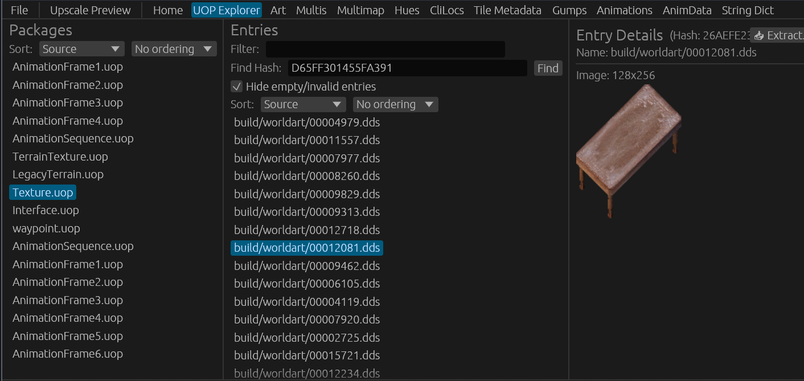

<details>
<summary><b>Click to expand individual view screenshots</b></summary>

#### Client Art & Tiledata
| Classic Client Tiledata | Enhanced Client Tile Art | Kingdom Reborn Art |
| ---------------------- | ------------------------ | ------------------ |
| 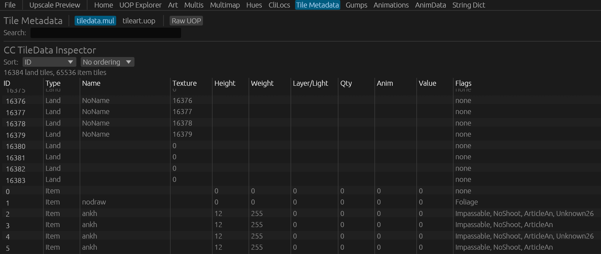 | 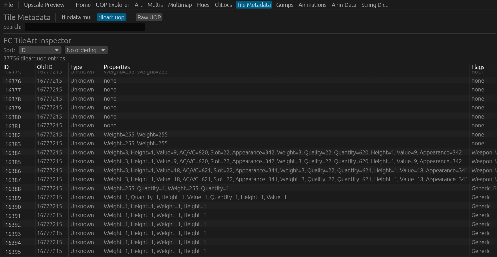 | 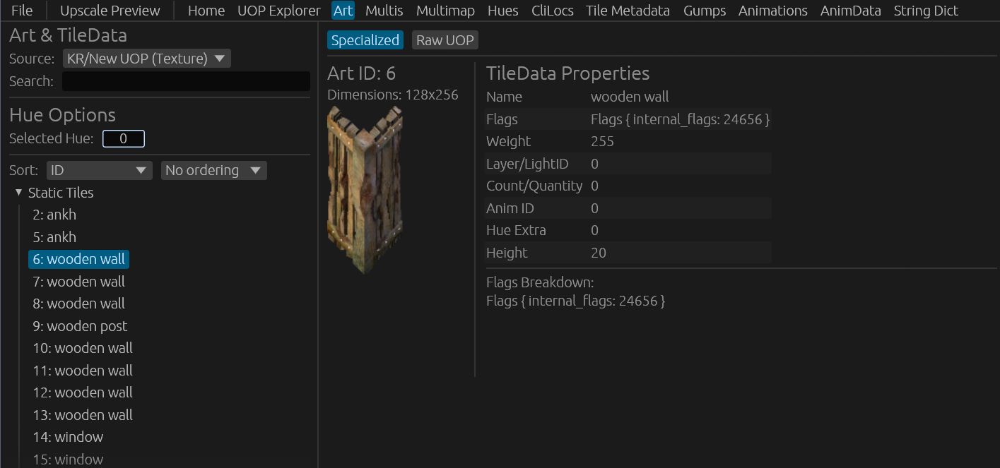 |

#### Localized Strings & Dictionaries
| Classic Client Clilocs | Enhanced Client Localized Strings | Enhanced Client String Dictionary |
| ---------------------- | --------------------------------- | --------------------------------- |
| 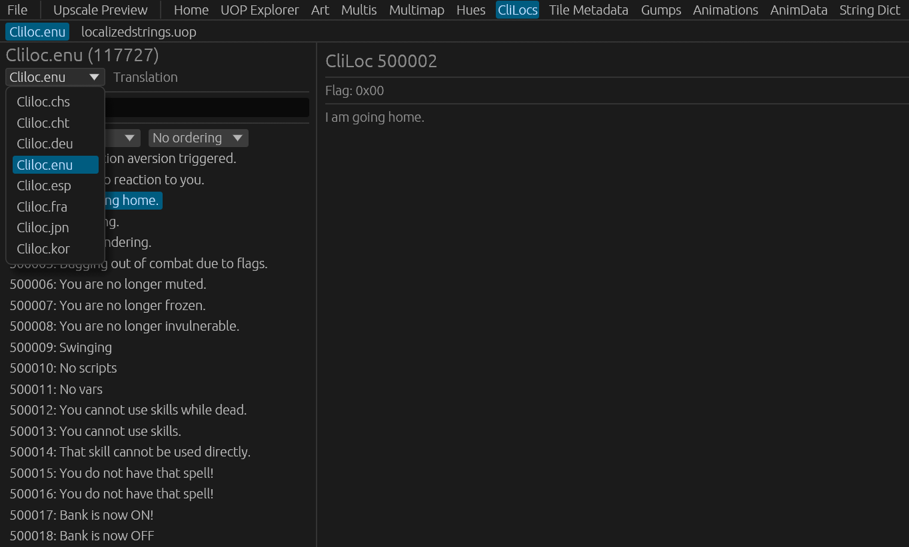 | 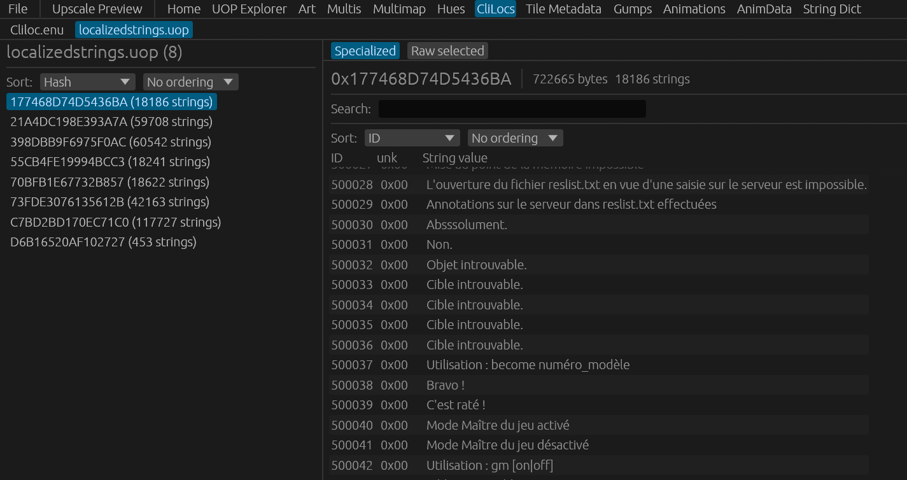 | 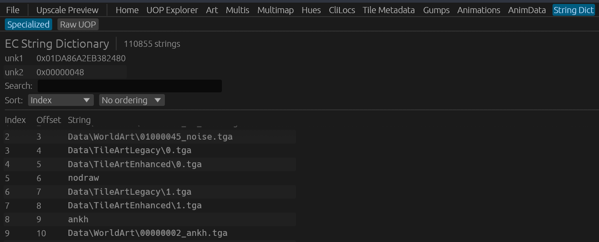 |

#### Hues & Palettes
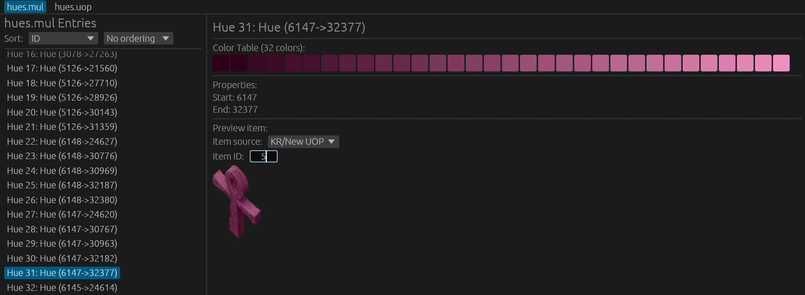

#### Animations & Multi-Tile Structures
| Classic Client UOP Animations | Classic Client Anim w/ Upscaler |
| ----------------------------- | ------------------------------- |
| 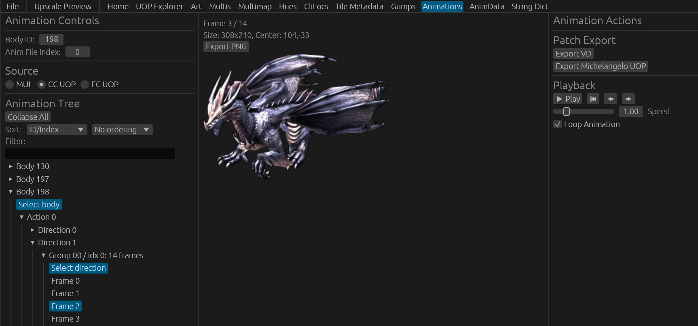 | 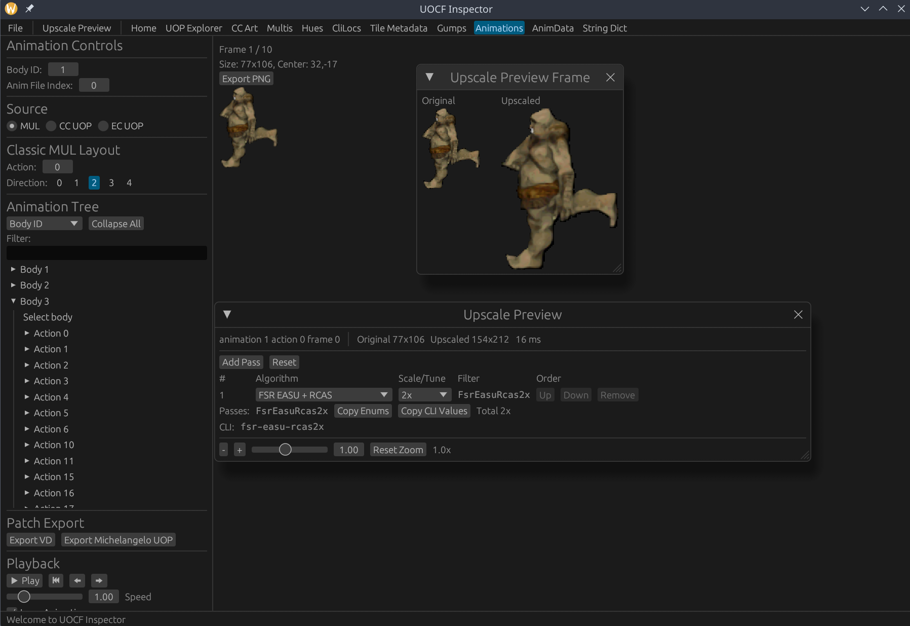 |

| Classic Client Multi (KR Art) | Enhanced Client Multi (CC Sprites) |
| ----------------------------- | ---------------------------------- |
| 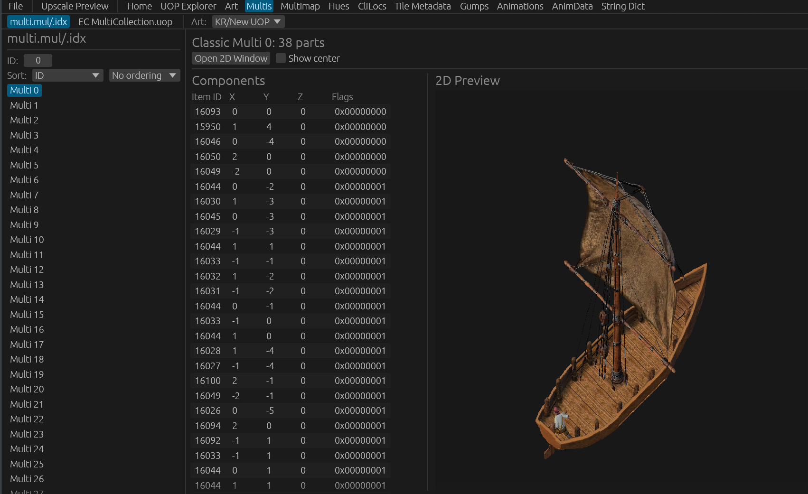 | 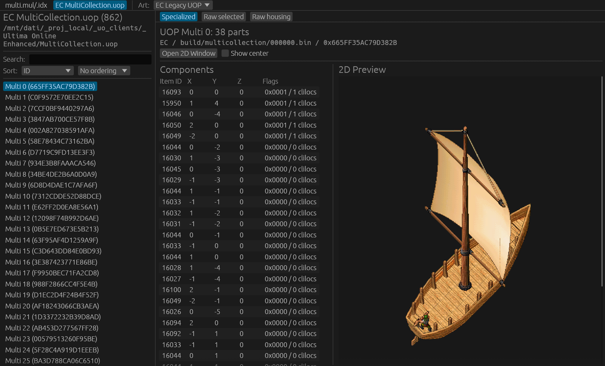 |

</details>

